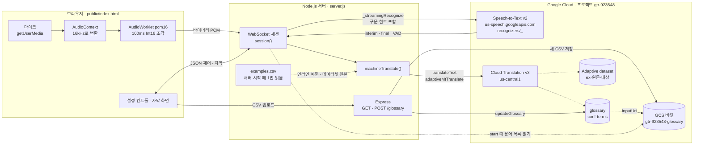
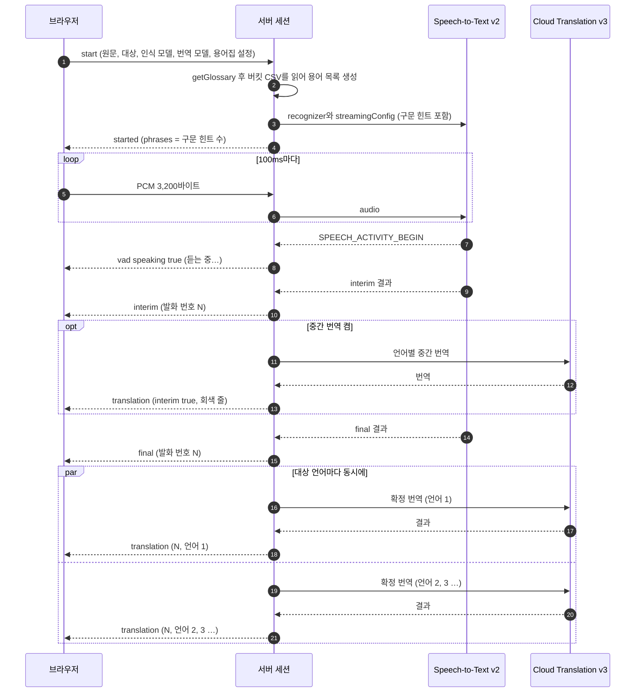
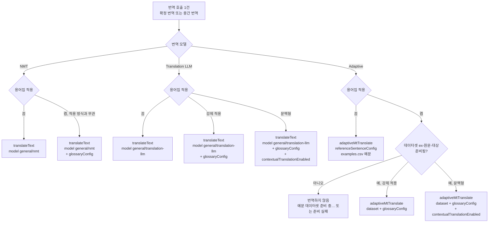
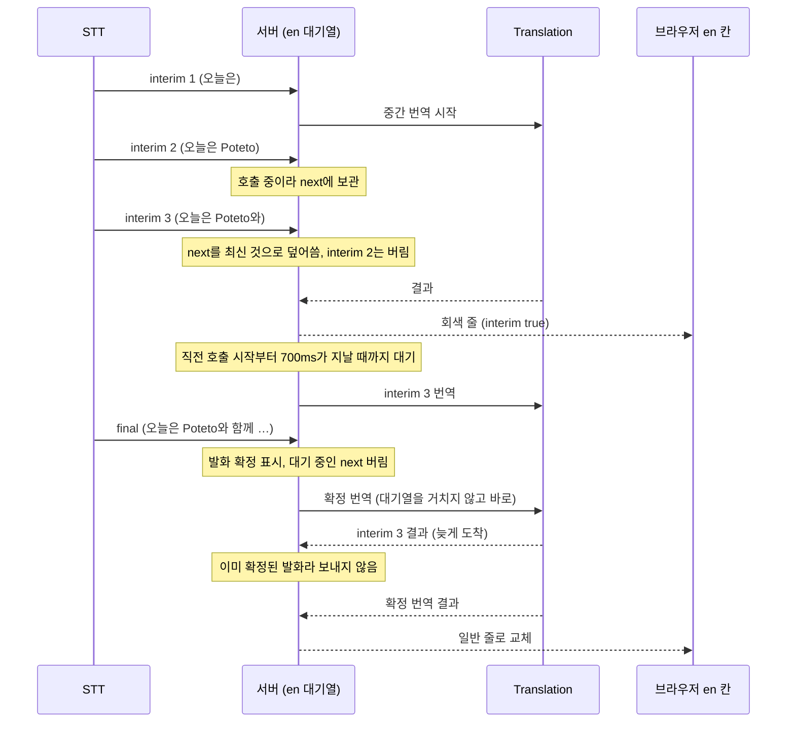
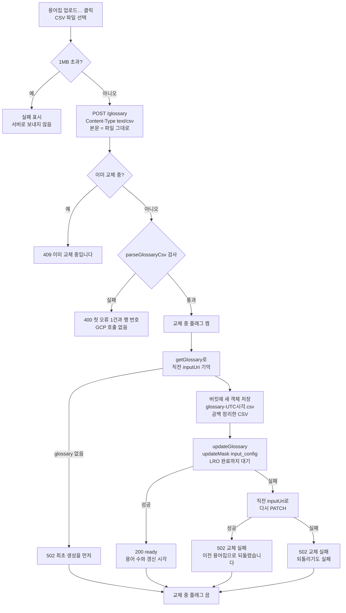
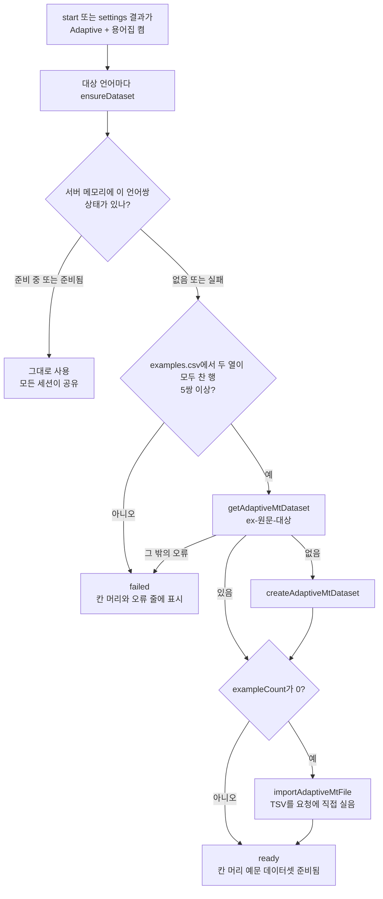
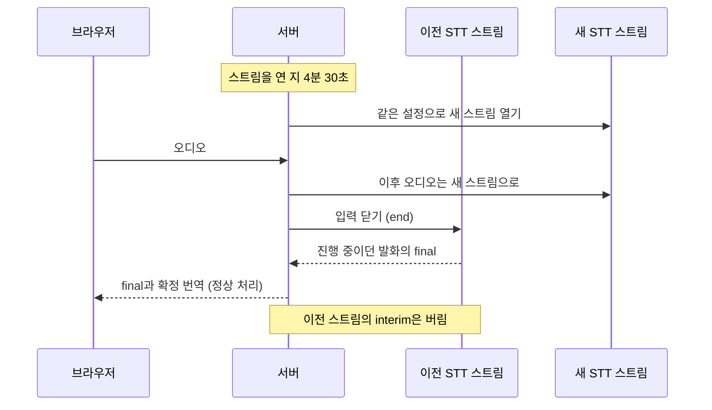
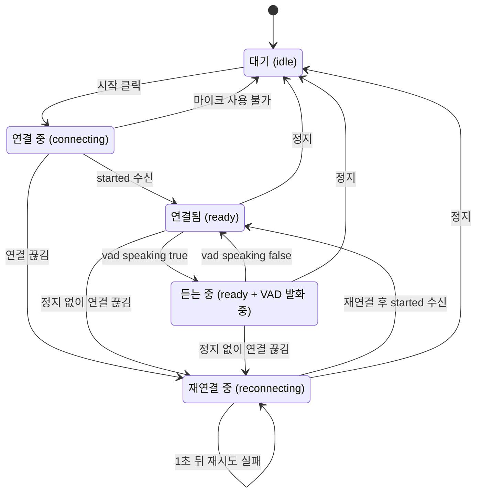
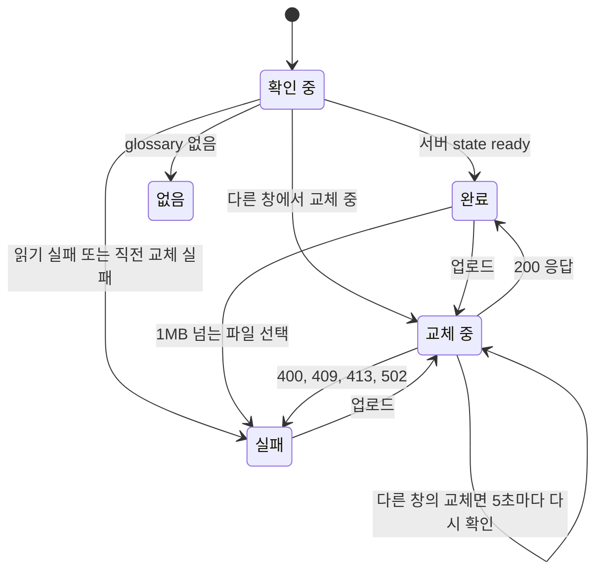
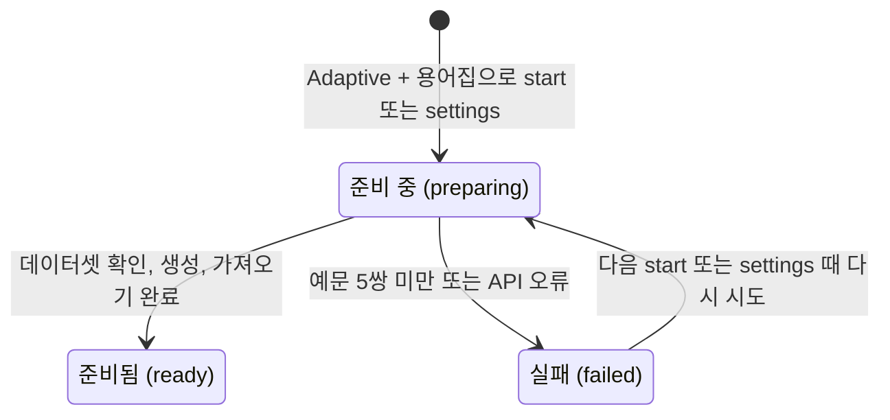

# 실시간 다국어 자막: 화면 옵션별 구현과 사용 가이드

브라우저 마이크로 말하면 원문 자막과 3개 이상 언어의 번역 자막이 함께 나오는 프로토타입이다. 이 문서는 화면의 각 옵션이 **어떻게 구현돼 있는지**, **무엇으로 연결했는지**, **어떻게 쓰는지**를 정리한다. 기준은 현재 `server.js`와 `public/index.html` 코드다.

> [!IMPORTANT]
> 이 문서의 측정값(지연시간, interim 빈도, 번역 결과 예시)은 모두 `PLAN.md`에 기록된 **2026-11-15 합성 음성(macOS `say`)·로컬 실행 기준 측정**이다. **실제 사람 목소리와 마이크로 말해서 자막·번역이 나오는 것은 아직 검증되지 않았다.** 브라우저 마이크에서 서버의 `started`까지와 레벨 미터에 소리가 잡히는 것까지만 확인했다. Cloud Run 배포도 아직 하지 않았다.

## 목차

1. [한눈에 보기](#1-한눈에-보기)
   - [전체 구조](#전체-구조)
   - [사용한 API와 리소스](#사용한-api와-리소스)
   - [문장 하나가 번역되어 나오기까지](#문장-하나가-번역되어-나오기까지)
2. [화면 옵션](#2-화면-옵션)
   - [화면 배치](#화면-배치)
   - [옵션 목록](#옵션-목록)
   - [서버와 주고받는 메시지](#서버와-주고받는-메시지)
3. [경우별 구현](#3-경우별-구현)
   - [인식 모델 long과 chirp_3](#인식-모델-long과-chirp_3)
   - [번역 모델과 용어집 조합](#번역-모델과-용어집-조합)
   - [용어 강조 계산](#용어-강조-계산)
   - [중간 번역](#중간-번역)
   - [용어집 업로드](#용어집-업로드)
   - [Adaptive 예문 데이터셋 자동 준비](#adaptive-예문-데이터셋-자동-준비)
   - [스트림 교체와 자동 재연결](#스트림-교체와-자동-재연결)
   - [상태 정리](#상태-정리)
4. [사용 방법](#4-사용-방법)
   - [사전 준비](#사전-준비)
   - [실행](#실행)
   - [목적별 추천 설정](#목적별-추천-설정)
   - [용어집 CSV 작성 규칙](#용어집-csv-작성-규칙)
   - [예문 CSV 작성 규칙](#예문-csv-작성-규칙)
   - [점검 스크립트](#점검-스크립트)
5. [알려진 한계와 주의](#5-알려진-한계와-주의)

---

## 1. 한눈에 보기

### 전체 구조



- 서버는 프로세스 1개다. 정적 파일(`public/`)과 WebSocket(`ws`)과 용어집 HTTP(`/glossary`)를 같은 포트(기본 8080)에서 처리한다.
- 브라우저에는 키가 없다. 서버가 ADC(Application Default Credentials)로 Google API를 부른다.
- 용어집(glossary)은 번역에, 같은 CSV의 **원문 언어 열**은 STT 구문 힌트에, **대상 언어 열**은 화면의 용어 강조에 쓰인다. 서버는 로컬 `glossary.csv`가 아니라 **버킷에 있는 CSV**(glossary의 `inputUri`)를 읽는다.
- `examples.csv`는 Adaptive 번역의 예문이다. 서버 시작 때 한 번 읽는다.

### 사용한 API와 리소스

**Google API**

| 단계 | API · 메서드 | 엔드포인트 · 리전 | 쓰는 곳 |
|---|---|---|---|
| 음성 인식 | Speech-to-Text **v2** `StreamingRecognize` (`_streamingRecognize`) | `us-speech.googleapis.com`, recognizer `projects/gtr-923548/locations/us/recognizers/_` | 세션마다 스트림 1개 |
| 번역 (NMT, Translation LLM) | Cloud Translation **v3** `translateText` | `us-central1` | 확정·중간 번역 |
| 번역 (Adaptive) | Cloud Translation v3 `adaptiveMtTranslate` | `us-central1` | 확정·중간 번역 |
| 용어집 조회·교체 | `getGlossary`, `updateGlossary`(LRO) | `us-central1` | `start`, `GET`·`POST /glossary` |
| 예문 데이터셋 | `getAdaptiveMtDataset`, `createAdaptiveMtDataset`, `importAdaptiveMtFile` | `us-central1` | Adaptive + 용어집 |
| 파일 저장·읽기 | Cloud Storage | 버킷 `gtr-923548-glossary` (`us-central1`) | 용어집 CSV |

**Node 패키지** (`package.json`)

| 패키지 | 버전 범위 | 역할 |
|---|---|---|
| `@google-cloud/speech` | `^8.2.1` | `speech.v2.SpeechClient` |
| `@google-cloud/translate` | `^10.3.0` | `TranslationServiceClient`(v3) |
| `@google-cloud/storage` | `^9.0.0` | 버킷 CSV 저장·다운로드 |
| `express` | `^5.3.0` | 정적 파일, `/glossary`, `express.raw`로 CSV 본문 받기 |
| `ws` | `^8.23.0` | WebSocket 서버 |

CSV 파서, 마이크 처리 라이브러리는 쓰지 않는다. 브라우저 쪽은 표준 API(`getUserMedia`, `AudioContext`, `AudioWorklet`, `WebSocket`, `fetch`)만 쓴다.

**GCP 리소스**

| 리소스 | 값 | 비고 |
|---|---|---|
| 프로젝트 | `gtr-923548` | 환경 변수 `GOOGLE_CLOUD_PROJECT`(또는 `.env`)로 정한다. 버킷·glossary 이름도 `GLOSSARY_BUCKET`·`GLOSSARY_ID`로 바꿀 수 있다([`SETUP.md`](SETUP.md)) |
| 버킷 | `gs://gtr-923548-glossary` | 업로드마다 `glossary-<UTC시각>.csv`가 새로 쌓인다(지우지 않음) |
| glossary | `projects/gtr-923548/locations/us-central1/glossaries/conf-terms` | 10개 언어 equivalent term set 1개만 관리. 최초 생성은 수동(`PLAN.md` 5.1절) |
| Adaptive dataset | `projects/gtr-923548/locations/us-central1/adaptiveMtDatasets/ex-<원문>-<대상>` | 언어쌍마다 1개, 서버가 자동으로 만든다(예: `ex-ko-en`, `ex-zh-cn-ko`) |
| STT recognizer | 기본 `_` | 따로 만들지 않고 config를 요청에 넣는다 |

### 문장 하나가 번역되어 나오기까지



- 확정 번역은 final 1건마다 대상 언어 수만큼 동시에 부르고, 끝나는 대로 따로 보낸다. 한 언어가 실패해도 다른 칸은 계속 나온다.
- 같은 번호(`id`)가 원문 줄과 번역 줄을 잇는다. 번역이 늦게 와도 같은 줄에 붙는다.

---

## 2. 화면 옵션

### 화면 배치

```
┌─ 설정 ─────────────────────────────────────────────
│ 원문 언어[한국어 ▼]  인식 모델[long ▼]  번역 모델[NMT ▼]  (●)용어집 적용
│ 적용 방식[강제 적용 ▼]  (●)중간 번역      ● 대기   [ 시작 ]
│ 번역할 언어 (3개 이상)
│   (한국어) (●영어) (●중국어 간체) (스페인어) (힌디어) (포르투갈어)
│   (러시아어) (●일본어) (프랑스어) (독일어)    ← 원문 언어 칩은 비활성·취소선
│ 안내 줄: 인식 모델 / 적용 방식 / 번역 모델 안내, 빨간 오류 줄
│ ──────────────────────────────────────────
│ 용어집 [완료] 용어집: 9개 · 11-15 14:02 갱신        [용어집 업로드…]
└────────────────────────────────────────────────────
┌─ 원문  한국어                         ▁▂▅▃▁ (레벨 미터)
│   1  확정 문장
│      회색 진행 중 줄 (interim 텍스트 또는 "듣는 중…")
└────────────────────────────────────────────────────
┌─ 영어  번역          ┌─ 중국어 간체  번역     ┌─ 일본어  번역
│ 1 …[용어]…           │ 1 …                    │ 1 …
│       NMT · 540ms    │       NMT · 512ms      │       NMT · 498ms
│ 2 회색 중간 번역      │                        │
```

- 번역 칸은 언어 목록 순서(ko, en, zh-CN, es, hi, pt, ru, ja, fr, de)대로 놓인다. 칸 머리의 작은 글씨는 평소 `번역`이고, Adaptive + 용어집으로 진행 중이면 예문 데이터셋 상태가 된다.
- 번역 줄 끝에는 `번역 모델 · 걸린 시간`이 붙는다. 문맥형이면 `LLM 문맥 · 358ms`처럼 `문맥`이 붙는다.
- 노란 `<mark>`는 용어 강조다([용어 강조 계산](#용어-강조-계산)). 줄에 마우스를 올리거나 누르면 같은 번호의 원문·번역 줄이 함께 강조된다.
- 화면의 ms 값과 용어 수(위 그림의 9개)는 예시다.

### 옵션 목록

| 컨트롤 | 선택지 | 기본값 | 진행 중 변경 | 바꾸면 반영되는 때 | 서버로 가는 필드 |
|---|---|---|---|---|---|
| 원문 언어 | 10개 언어(ko, en, zh-CN, es, hi, pt, ru, ja, fr, de) | 한국어 `ko` | ❌ | 다음 시작 | `start.source` |
| 번역할 언어 | 원문을 뺀 9개 중 **3개 이상**(화면 규칙) | 영어·일본어·중국어 간체 | ❌ | 다음 시작 | `start.targets` |
| 인식 모델 | `long`(중간 결과 자주) / `chirp_3`(중간 결과 드묾) | `long` | ❌ | 다음 시작 | `start.model` |
| 번역 모델 | NMT / Translation LLM / Adaptive (예문) | NMT | ✅ | 다음 번역 호출 | `mt` = `nmt`, `llm`, `adaptive` |
| 용어집 적용 | 켬 / 끔 | 켬 | ✅ | 다음 번역 호출 | `glossary` |
| 적용 방식 | 강제 적용 / 문맥형 | 강제 적용 | ✅ (용어집이 꺼졌거나 NMT면 비활성) | 다음 번역 호출 | `glossaryMode` = `forced`, `contextual` |
| 중간 번역 | 켬 / 끔 | 켬 | ✅ | 다음 중간 번역 호출 | `interim` |
| 시작 · 정지 | 버튼 1개(진행 중이면 `정지`) | 대기 | | 즉시 | `start` / `stop` 메시지 |
| 용어집 업로드… | CSV 파일 1개(1MB 이하) | | ❌ (정지 상태에서만) | 번역: 교체 완료 직후. 구문 힌트·용어 강조: 다음 시작 | HTTP `POST /glossary` |

진행 중 변경과 반영 규칙(코드 기준):

- 정지 상태에서 바꾼 값은 서버로 따로 보내지 않고 다음 `start`에 실린다. 진행 중에 바꾸면 `settings` 메시지가 네 필드(`glossary`, `interim`, `mt`, `glossaryMode`)를 한꺼번에 보낸다. 브라우저는 재연결 때를 위해 기억한 `start` 메시지에도 바뀐 값을 넣는다.
- `settings`는 **이미 보낸 번역 호출에는 영향이 없다.** 확정 번역은 final이 도착한 순간의 설정을, 중간 번역은 호출을 시작하는 순간의 설정을 쓴다.
- 원문 언어·번역할 언어·인식 모델은 STT 스트림 설정이라 진행 중에는 잠긴다. 바꾸려면 정지 후 다시 시작한다.
- **용어집 적용을 꺼도 STT 구문 힌트는 그대로다.** 힌트 사용 여부는 인식 모델과 원문 언어로만 정해진다(`NO_HINTS`).
- 적용 방식: NMT를 고르면 화면은 `강제 적용`으로 고정·비활성되지만, 사용자가 전에 고른 값(`st.glMode`)은 기억해 두고 `glossaryMode`로 그대로 보낸다. 서버는 NMT면 이 값을 무시한다(`contextualOf`). LLM·Adaptive로 돌아가면 기억한 값이 되살아난다.
- 번역할 언어 3개 이상은 **화면 규칙**이다. 서버는 원문과 다른 유효 언어가 1개 이상이면 받는다.
- 서버는 허용 목록 밖의 값을 기본값으로 바꾼다: `model` → `long`, `mt` → `nmt`, `glossaryMode` → `forced`. `interim`은 `false`가 아니면 켬이다.
- [시작]은 대상 언어가 3개 미만이거나 용어집 교체 중이면 비활성이다. 서버도 교체 중이면 `start`를 거절한다(`용어집 교체 중에는 시작할 수 없습니다`).

옵션에 따라 나타나는 안내 줄:

| 조건 | 안내 문구(요약) |
|---|---|
| 인식 모델 `long` + 원문이 한국어·중국어 간체·힌디어·러시아어 | long 모델은 이 원문에서 구문 힌트를 지원하지 않아 힌트 없이 인식한다. 힌트가 필요하면 chirp_3 |
| 용어집 켬 | 강제 적용은 용어가 지켜지지만 조사 앞 공백·조사 누락 가능, 문맥형은 자연스럽지만 용어가 안 지켜질 수 있음. NMT면 앞에 "NMT는 문맥형을 지원하지 않아 강제 적용으로 고정됩니다." |
| Adaptive + 용어집 켬 | 예문 데이터셋 방식이라 약 2초, 중간 번역 자동으로 꺼짐, 없는 언어쌍은 처음 쓸 때 만듦 |
| Adaptive + 용어집 끔 | `examples.csv` 예문을 요청에 직접 넣어 번역 |
| 진행 중 또는 교체 중 | 진행 중에는 용어집을 올릴 수 없다 / 교체가 끝날 때까지 시작할 수 없다 |

### 서버와 주고받는 메시지

WebSocket 하나로 오디오(바이너리 프레임)와 제어·자막(텍스트 JSON 프레임)을 함께 보낸다. 용어집만 HTTP다.

| 방향 | `type` | 주요 필드 |
|---|---|---|
| 브라우저 → 서버 | `start` | `source`, `targets`, `model`, `mt`, `glossary`, `glossaryMode`, `interim` |
| 브라우저 → 서버 | (바이너리) | LINEAR16, 16kHz, mono, 100ms(3,200바이트) 조각. `started`를 받은 뒤부터 보낸다 |
| 브라우저 → 서버 | `settings` | `glossary`, `interim`, `mt`, `glossaryMode` |
| 브라우저 → 서버 | `stop` | 없음 |
| 서버 → 브라우저 | `started` | `model`, `mt`, `phrases`(구문 힌트 수, 힌트를 못 쓰면 0) |
| 서버 → 브라우저 | `vad` | `speaking` |
| 서버 → 브라우저 | `interim` · `final` | `id`, `text` |
| 서버 → 브라우저 | `translation` | `id`, `lang`, `mt`, `text`, `ms`, `terms`, 문맥형이면 `contextual: true`, 중간 번역이면 `interim: true` |
| 서버 → 브라우저 | `dataset` | `lang`, `state`(`preparing` / `ready`+`ms` / `failed`+`error`) |
| 서버 → 브라우저 | `error` | `message`. `id`·`lang`이 있으면 그 칸의 오류, 없으면 세션 오류. 데이터셋 준비 중이면 `pending: true` |

---

## 3. 경우별 구현

### 인식 모델 long과 chirp_3

**호출 방식은 두 모델이 같다.** 바뀌는 것은 config의 `model` 값과 구문 힌트를 넣는지뿐이다.

```js
// server.js openStream(): 첫 메시지
s.write({ recognizer: 'projects/gtr-923548/locations/us/recognizers/_',
  streamingConfig: {
    config: {
      explicitDecodingConfig: { encoding: 'LINEAR16', sampleRateHertz: 16000, audioChannelCount: 1 },
      languageCodes: ['ko-KR'],          // LANGS 표로 변환
      model: 'long',                     // 또는 'chirp_3'
      adaptation: { phraseSets: [{ inlinePhraseSet: { phrases: [{ value: 'Poteto', boost: 10 }, …] } }] }, // 힌트를 쓸 때만
    },
    streamingFeatures: { interimResults: true, enableVoiceActivityEvents: true } } });
// 이후에는 { audio: <PCM> }만 write
```

- `@google-cloud/speech`의 `streamingRecognize()` 헬퍼는 v1 형식이라 v2에 맞지 않아, 원 메서드 `_streamingRecognize()`에 객체를 직접 쓴다.
- 구문 힌트는 용어 목록의 **원문 언어 열**에서 만든다: 빈 칸 제외, 100자 이하, 최대 1,000개, `boost: 10`. 용어 목록은 `start` 때 버킷에서 읽는다.
- 언어 코드 변환: `en→en-US`, `zh-CN→cmn-Hans-CN`, `es→es-ES`, `hi→hi-IN`, `pt→pt-BR`, `ru→ru-RU`, `ja→ja-JP`, `ko→ko-KR`, `fr→fr-FR`, `de→de-DE`.

**두 모델의 차이** (2026-11-15 합성 음성·로컬 기준 측정, `PLAN.md` 4.1절)

| 항목 | `long` | `chirp_3` |
|---|---|---|
| interim 빈도 | 단어 단위로 자주. 쉼 있는 영어 3문장 64번, 연속 19.4초 241번, 한국어 2문장 37번 | 오디오 **약 5초마다 1번**. 5초 미만 발화는 0번 |
| 첫 interim | 오디오 전송 시작 후 약 1.2~2.0초 | 약 6초(5초 넘게 이어 말할 때만) |
| final 지연(발화 끝 → final) | 약 1.1~1.7초 | 약 1.9~2.5초 |
| final이 끊기는 단위 | 쉼 단위(0.4초 쉼은 합침, 약 1초 쉼에서 나뉨) | 같음 |
| 문장부호·대소문자 | 없음, 영어는 소문자 | 있음 |
| 구문 힌트 | en, es, pt, ja, fr, de만. **ko, zh-CN, hi, ru는 API가 거부**해 서버가 힌트를 넣지 않는다 | 10개 언어에 넣는다(실제 확인은 en·ko·cmn) |
| VAD 이벤트 | 됨 | 됨 |
| 영어 "Poteto" 받아쓰기(힌트 있음) | `potato` | `Poteto` |
| 화면에서 보이는 모습 | 말하는 동안 회색 원문이 계속 바뀌고, 중간 번역도 자주 갱신된다 | 말하는 동안 주로 "듣는 중…"(VAD)만 보이고 문장이 끝나면 확정 줄이 나온다 |

- 서버의 힌트 판단: `hints = !NO_HINTS[model]?.includes(source)`, `NO_HINTS = { long: ['zh-CN', 'hi', 'ru', 'ko'] }`. 화면도 같은 목록(`LONG_NO_HINTS`)으로 안내 줄을 띄운다. 모델을 자동으로 바꾸지는 않는다.
- 문장부호 차이 예(중국어 합성 음성): `long` `上下文疮口很大我们明天会提交代码`(한 글자 오인식, 문장부호 없음), `chirp_3` `上下文窗口很大,我们明天会提交代码。`
- 영어 원문 + `long`에서는 STT가 `potato`로 적어 용어집의 `Poteto`가 매칭되지 않는다. 한국어 원문 + `long`은 `포테토는`으로 원문 표기에 더 가까웠다(`chirp_3`는 `포테이토는`).
- 중간 번역은 interim이 있어야 생기므로, `chirp_3`에서는 중간 번역 효과가 거의 없다. 그래서 기본값이 `long`이다.

### 번역 모델과 용어집 조합

번역 호출은 `machineTranslate(mt, text, source, lang, useGlossary, contextual)` 함수 하나에서 갈라진다. 문맥형 여부는 `contextualOf(c) = c.glossary && c.glossaryMode === 'contextual' && c.mt !== 'nmt'`로 정한다.



공통 값:

- `parent` = `projects/gtr-923548/locations/us-central1`, `mimeType: 'text/plain'`
- `translateText`의 `model` = `projects/gtr-923548/locations/us-central1/models/general/nmt`(NMT) 또는 `projects/gtr-923548/locations/us-central1/models/general/translation-llm`(Translation LLM)
- `glossaryConfig` = `{ glossary: 'projects/gtr-923548/locations/us-central1/glossaries/conf-terms', ignoreCase: true }`. 문맥형이면 여기에 `contextualTranslationEnabled: true`가 더해진다.
- `ignoreCase: true`는 STT 결과의 대소문자가 일정하지 않아서 둔다(`poteto`도 `Poteto` 행에 매칭).
- 모든 결과는 HTML 엔티티 6종(`&quot;` `&amp;` `&lt;` `&gt;` `&#39;` `&#x27;`)을 한 번 되돌린 뒤(`unesc`) 화면에 보낸다. LLM 강제 적용과 Adaptive 데이터셋 결과가 `text/plain`인데도 엔티티를 섞어 보내기 때문이다.

**한눈에 보는 3 × 3**

| 번역 모델 | 용어집 끔 | 강제 적용 | 문맥형 |
|---|---|---|---|
| NMT | `translateText` (nmt) | `translateText` (nmt) + `glossaryConfig` | ❌ 불가 → 강제 적용으로 고정 |
| Translation LLM | `translateText` (translation-llm) | `translateText` (translation-llm) + `glossaryConfig` | `translateText` (translation-llm) + `glossaryConfig` + `contextualTranslationEnabled` |
| Adaptive | `adaptiveMtTranslate` + `referenceSentenceConfig`(인라인 예문) | `adaptiveMtTranslate` + `dataset` + `glossaryConfig` | `adaptiveMtTranslate` + `dataset` + `glossaryConfig` + `contextualTranslationEnabled` |

**조합별 상세 매트릭스** (실제로 갈라지는 8가지)

| 조합 | 화면에 쓰는 결과 | 용어가 지켜지나 | 한국어 조사 | 확정 번역 지연(대략) | 중간 번역 |
|---|---|---|---|---|---|
| NMT · 끔 | `translations[0]` | 해당 없음 | 정상 | 약 120~230ms ¹ | ✅ |
| NMT · 강제 적용 | `glossaryTranslations[0]` | ✅ | 조사 앞 공백·누락 | 130~560ms ² (단건 호출 기준 대부분 540~730ms ¹) | ✅ |
| NMT · 문맥형 | (강제 적용과 같음) | | | | |
| LLM · 끔 | `translations[0]` | 해당 없음 | 정상 | 중앙값 461ms ¹ | ✅ |
| LLM · 강제 적용 | `glossaryTranslations[0]` | ✅ | 조사 앞 공백·누락 | 400~500ms ² | ✅ |
| LLM · 문맥형 | `glossaryTranslations[0]` (`translations`는 빈 문자열로 옴) | ⚠️ 시험한 문장에서는 지켜지지 않음 | 정상 | 360~750ms ² (단건 호출 중앙값 802ms ¹) | ✅ |
| Adaptive · 끔 | `translations[0]` | 해당 없음 | 정상 | 360~510ms ² | ✅ |
| Adaptive · 강제 적용 | `glossaryTranslations[0]` | ✅ | 조사 앞 공백·누락 | 1.9~2.0초 ² | ❌ 자동으로 꺼짐 |
| Adaptive · 문맥형 | `glossaryTranslations[0]` (`translations`는 빈 배열) | ⚠️ 시험한 문장에서는 지켜지지 않음 | 정상 | 1.9~2.1초 ² | ❌ 자동으로 꺼짐 |

¹ 스크립트로 번역 API만 직접 부른 값(`PLAN.md` 4.2·4.3절, en→ko 짧은 문장). ² 서버 WebSocket 경로로 WAV를 흘린 `check-ws.mjs`의 확정 번역 지연(`PLAN.md` 4.4절, en→ko). 모두 2026-11-15 합성 음성·로컬 기준 측정이고, 첫 호출은 더 느리다(NMT 약 0.7~1.2초).

조합별로 막히거나 고정되는 이유:

- **NMT + 문맥형 불가**: NMT에 `contextualTranslationEnabled`를 주면 `3 INVALID_ARGUMENT: Contextual translation is only supported for LLM models.`로 실패한다. 그래서 서버는 NMT에서 문맥형을 무시하고, 화면은 `강제 적용`으로 고정해 보여 준다.
- **Adaptive + 용어집은 인라인 예문을 쓸 수 없다**: 인라인 예문(`referenceSentenceConfig`)에 `glossaryConfig`를 붙이면 `13 INTERNAL: Persistent dataset is null.`로 실패한다. 그래서 용어집을 켠 Adaptive는 언어쌍별 **예문 데이터셋**(`dataset`)으로 부른다. 데이터셋과 `referenceSentenceConfig`는 함께 줄 수 없다(`Dataset must be unset if reference_sentence_config is set.`).
- **Adaptive는 요청에 언어 코드가 없다**: 데이터셋 방식은 대상 언어를 데이터셋이 정하므로 대상 언어마다 데이터셋이 필요하다. 인라인 예문 방식은 `referenceSentenceConfig`에 `sourceLanguageCode`·`targetLanguageCode`를 넣는다.
- **Adaptive + 용어집에서 중간 번역이 꺼지는 이유**: 데이터셋 방식 호출이 약 2초라 0.7초 간격 중간 번역에 쓸 수 없다. 체크박스 값은 그대로 두고 서버만 건너뛴다(`interimOn()`). 다른 모델로 바꾸거나 용어집을 끄면 다시 동작한다.
- **Adaptive 예문이 없는 언어**: 인라인 방식은 원문·대상 열이 모두 찬 예문이 1쌍 이상, 데이터셋 방식은 5쌍 이상 있어야 한다. 현재 `examples.csv`는 `hi` 열이 비어 있어 힌디어가 끼면 Adaptive가 그 칸에서 실패한다.

**같은 문장의 결과 비교** (en→ko, `check-ws.mjs`, `chirp_3`, 2026-11-15 합성 음성·로컬 기준 측정, 대괄호 = 강조된 용어)

| 조합 | "Yesterday I met Matt and Lauren Tan at SpaceX." | "The context window of this model is large." |
|---|---|---|
| NMT · 강제 적용 | 어제 저는 SpaceX 에서 Matt 과 Lauren Tan 만났습니다. [Matt, Lauren Tan] | 이 모델의 컨텍스트 윈도우 넓습니다. [컨텍스트 윈도우] |
| LLM · 강제 적용 | 어제 저는 SpaceX 에서 Matt 과 Lauren Tan 만났습니다. [SpaceX, Matt, Lauren Tan] | 이 모델의 컨텍스트 윈도우 큽니다. [] |
| LLM · 문맥형 | 어제 저는 스페이스X에서 맷과 로렌 탄을 만났습니다. [] | 이 모델의 컨텍스트 윈도우는 큽니다. [컨텍스트 윈도우] |
| Adaptive · 강제 적용 | 어제 저는 SpaceX 에서 Matt 과 Lauren Tan 만났습니다. [SpaceX, Matt, Lauren Tan] | 이 모델의 컨텍스트 윈도우 큽니다. [] |
| Adaptive · 문맥형 | 어제 저는 스페이스X에서 맷과 로렌 탄을 만났습니다. [] | 이 모델의 컨텍스트 윈도우는 큽니다. [컨텍스트 윈도우] |
| Adaptive · 끔 | 어제 저는 스페이스X에서 맷과 로렌 탄을 만났습니다. [] | 이 모델의 컨텍스트 윈도우는 큽니다. [] |

용어집을 끈 NMT·LLM은 API 직접 호출 결과로 같은 두 번째 문장이 NMT `이 모델의 컨텍스트 창은 넓습니다.`, LLM `이 모델의 컨텍스트 윈도우는 큽니다.`였다(`PLAN.md` 4.3절).

읽는 법:

- 강제 적용은 세 모델 모두 용어를 지켰고, `SpaceX 에서`·`Matt 과`(조사 앞 공백), `Lauren Tan 만났습니다`("을" 누락), `윈도우 큽니다`·`윈도우 넓습니다`("는"·"은" 누락)가 생긴다.
- 문맥형은 시험한 모든 문장에서 **용어집을 끈 결과와 같았다**(`맷`, `스페이스X`). 조사 문제가 없는 것은 용어가 적용되지 않았기 때문으로 본다.
- STT가 `long`에서 소문자로 적은 "Matt pocock and Lauren tan work at SpaceX"도 강제 적용은 `Matt Pocock 과 Lauren Tan SpaceX 에서 …`로 용어집 표기를 따랐다(`ignoreCase`).

### 용어 강조 계산

글자 단위 diff를 쓰지 않는다. `start` 때 읽은 용어 목록의 **대상 언어 열**만 본다.

```text
강조할 용어 = 대상 언어 열의 용어 중
              (화면에 쓴 결과 out에 있고) AND (적용 전 번역 plain에 없는) 것
              비교는 대소문자를 무시한 부분 문자열 검색
용어집 끔이면 강조하지 않는다 (terms = [])
```

| 조합 | `plain`(비교 대상) | 강조의 의미 |
|---|---|---|
| 용어집 끔 (세 모델) | (계산 안 함) | 강조 없음 |
| NMT·LLM 강제 적용 | `translations[0]` = 용어집 적용 전 번역 | 용어집 때문에 **바뀐** 용어 |
| Adaptive 강제 적용 | `translations[0]` = 이미 조사 앞 공백이 들어간 형태 | 용어 포함 여부만 보므로 그대로 비교. 바뀐 용어에 가깝다 |
| LLM·Adaptive 문맥형 | 빈 문자열 | 결과에 들어 있는 대상 언어 용어 **전부**. "바뀐 용어"가 아니라 "결과에 든 용어"다 |

- 브라우저는 번역을 `textContent`로 넣고, `terms`의 위치만 잘라 `<mark class="term">`로 감싼다(긴 용어부터 매칭). 번역 결과를 `innerHTML`로 넣지 않는다.
- 모든 언어가 같은 표기인 용어(예: `pstack`)는 적용 전에도 같은 문자열이면 강제 적용에서 강조되지 않는다. 예: LLM 강제 적용에서 `Poteto`가 강조되지 않은 것은 적용 전 번역에도 `Poteto`가 있었기 때문이다.
- 용어 목록은 `start` 때 고정된다. 진행 중 용어집이 바뀌어도 강조와 구문 힌트는 다음 시작부터 새 목록을 쓴다.

### 중간 번역

말하는 도중의 interim 원문을 대상 언어별로 번역해 회색 줄로 보여 주고, 확정 번역이 오면 일반 줄로 바꾼다.



**흐름 규칙** (`queueInterim`, `pump`)

| 규칙 | 구현 |
|---|---|
| 언어별 동시 1개 | 언어마다 대기열 `{ busy, next, last, at, timer }`. `busy`면 새 호출을 시작하지 않는다 |
| 최신 것만 | 기다리는 동안 온 interim은 `next` 하나에 덮어쓴다 |
| 최소 간격 | 호출 **시작** 사이 `INTERIM_GAP_MS` = 700ms(상수) |
| 중복 생략 | 직전에 번역한 텍스트와 같으면 부르지 않는다 |
| 순서 꼬임 방지 | final이 오면 발화 번호를 `done`에 넣고 그 발화의 `next`를 버린다. 이미 보낸 호출의 결과가 final 뒤에 오면 버린다. 브라우저도 확정 번역을 중간 번역으로 덮지 않는다 |
| 실패 처리 | 중간 번역 실패는 화면에 표시하지 않는다(다음 interim이나 확정 번역이 대신한다) |
| 확정 번역 | 대기열·간격 제한 없이 final마다 언어별로 바로 부른다 |

**자동으로 꺼지는 경우**

- Adaptive + 용어집 켬(강제 적용, 문맥형 모두): 서버가 중간 번역을 하지 않는다.
- `chirp_3`: 꺼지지는 않지만 interim이 약 5초마다 1번이라 중간 번역도 거의 없다.

**번역 모델별 측정** (`check-ws.mjs`, `long`, 대상 ko/ja/es, 2026-11-15 합성 음성·로컬 기준 측정)

| 번역 모델 | 첫 중간 번역(오디오 시작 기준) | 갱신 간격 평균 | 중간 번역 1회 평균 | 20초 연속 발화 언어당 횟수 |
|---|---|---|---|---|
| NMT 용어집 켬 | 약 1.2초 | 0.69초 | 약 180~260ms | 29 |
| NMT 용어집 끔 | 약 0.75~1.4초 | 0.70초 | 약 165ms | 28~29 |
| LLM 문맥형 | 약 2.0초 | 0.73~0.79초 | 약 600~690ms | 24~26 |
| LLM 용어집 끔 | 약 1.5초 | 0.71초 | 약 490~510ms | 27 |
| Adaptive 용어집 끔 | 약 1.0~1.1초 | 0.71~0.72초 | 약 460~530ms | 28 |

중간 번역은 앞부분이 바뀌며 흔들린다(예: `감자` → `감자는 이렇게 말합니다.` → `potato는 컨텍스트 창이 크다고 말합니다.`). 한 단어 interim이 엉뚱하게 번역되기도 한다(`the` → `그만큼`).

**비용 영향**: 중간 번역은 진행 중 발화 **전체**를 매번 다시 번역하므로 발화가 길수록 문자 수가 크게 는다. 서버는 세션이 끝날 때 콘솔에 `session stats`(확정·중간 호출 수와 문자 수)를 찍는다.

| 음성(`long`, 대상 3개, 합성 음성) | 확정 번역 문자 | 중간 번역 호출 / 문자 | 배수(중간/확정) |
|---|---|---|---|
| 영어 3문장, 문장 사이 1.5초 쉼(10초) | 336자(9회) | 36회 / 795자 | 약 2.4배 |
| 한국어 2문장, 쉼 있음(6초) | 84자(6회) | 18회 / 129자 | 약 1.5배 |
| 영어 2문장, 쉼 있음(6초) | 207자(6회) | 18회 / 342자 | 약 1.7배 |
| 영어 1문장, 쉼 없이 19.4초 | 1,044자(3회) | 84~87회 / 약 15,500자 | 약 15배 |

번역 단가는 `PLAN.md`에서도 가격 페이지를 직접 읽지 못해 **미확인**이다. 비용이 걱정되면 중간 번역을 끄거나 `INTERIM_GAP_MS`를 늘린다.

### 용어집 업로드



- **전송**: 브라우저는 `File`을 그대로 본문에 넣는다(`file.text()`를 쓰면 UTF-8이 아닌 바이트가 바뀌어 서버의 인코딩 검사가 소용없어진다). 서버는 `express.raw({ type: 'text/csv', limit: '1mb' })`로 받는다. 1MB를 넘으면 413 `파일이 1MB를 넘습니다`.
- **검사 규칙**: [용어집 CSV 작성 규칙](#용어집-csv-작성-규칙) 참고. 실패하면 첫 오류 1건만, 파일의 줄 번호와 함께 돌려준다(예: `3행: 열이 9개입니다(10개 필요)`).
- **버킷 저장**: 받은 텍스트가 아니라 칸 앞뒤 공백·빈 줄을 정리하고 `\n` 줄바꿈으로 다시 쓴 CSV를 올린다(서버가 세는 용어와 glossary가 쓰는 용어를 맞추기 위해). 매번 새 이름(예: `glossary-20261114T160023503Z.csv`)으로 올리고 이전 객체는 지우지 않는다.
- **교체**: glossary를 지우고 다시 만들지 않고, `updateGlossary`로 입력 파일만 바꾼다(PATCH). 마스크 경로는 `input_config`다(Node gRPC는 `inputConfig`를 거부).
- **되돌리기가 필요한 이유**: PATCH가 실패해도 기존 용어는 남지만 glossary의 `inputUri`는 실패한 파일을 가리킨 채 남는다. 그대로 두면 다음 `start`의 용어 목록 읽기가 어긋나므로 직전 URI로 다시 PATCH한다.
- **교체 중 동작**: 교체 중에도 번역은 오류 없이 **이전 용어**로 나오고, 완료 직후 몇 초 동안 이전 용어가 남을 수 있다. 화면은 교체 중 [시작]과 업로드를 막는다.
- **반영 시점**: 번역은 같은 이름의 glossary를 부르므로 교체 완료 직후부터 새 용어를 쓴다. STT 구문 힌트와 용어 강조는 `start` 때 읽으므로 **다음 시작부터** 새 용어를 쓴다.
- **걸린 시간**: 용어 8~9개 기준 화면 업로드 전체 약 6초, PATCH 완료까지 약 6~10초(2026-11-15 로컬 기준 측정). 용어 1,000개일 때는 미확인.

**상태 표시** (`GET /glossary`, 페이지를 열 때 호출)

| 배지 | 서버 `state` | 표시 |
|---|---|---|
| 확인 중 | (화면 내부 `loading`) | `불러오는 중…` |
| 완료 | `ready` | `용어집: 9개 · 11-15 14:02 갱신`(용어 수 · glossary `endTime`) |
| 교체 중 | `updating` | `용어집 교체 중… (몇 분 걸릴 수 있음)`. 다른 창에서 시작한 교체면 5초마다 다시 확인 |
| 실패 | `failed` | 빨간 오류 한 줄 + 마지막으로 알던 현재 용어집 정보. 직전 교체 실패 메시지는 다음 성공 때까지 서버 메모리에 남는다 |
| 없음 | `none` | `용어집 없음`. 업로드 버튼 비활성(최초 생성은 수동) |

### Adaptive 예문 데이터셋 자동 준비

**언제**: 번역 모델이 Adaptive이고 용어집이 켜진 상태로 `start`하거나, 진행 중 `settings`로 그 조합이 되었을 때 대상 언어마다 준비를 시작한다. 준비를 기다리지 않고 바로 시작한다.



- **이름 규칙**: `ex-<원문>-<대상>`을 소문자로(`ex-en-ko`, `ex-ko-ja`, `ex-zh-cn-ko`). 표시 이름은 하이픈을 밑줄로 바꾼 값(`ex_en_ko`). 점검 스크립트가 만드는 `check-*`와 구분된다.
- **가져오기**: `examples.csv`의 두 열을 `원문\t대상` 한 줄 1쌍 TSV로 만들어 `fileInputSource`(mimeType `text/tab-separated-values`)로 요청에 직접 싣는다. 버킷을 쓰지 않는다.
- **상태 공유**: 언어쌍별 상태(`preparing` / `ready` / `failed`)는 서버 메모리의 표 하나에 있고 모든 세션이 같이 쓴다. 실패한 쌍은 다음 `start`/`settings` 때 다시 시도한다.
- **준비 중 동작**: 그 칸 머리가 `예문 데이터셋 준비 중…`이 되고, 그동안 확정된 문장은 그 칸에 회색 `예문 데이터셋 준비 중…` 한 줄로 남는다. **그 문장은 나중에 다시 번역하지 않는다.** 준비가 끝난 뒤 다음 문장부터 번역된다.
- **걸린 시간** (2026-11-15 로컬 기준 측정): 데이터셋이 없을 때 언어쌍마다 약 3~11초(병렬). 같은 서버로 두 번째 시작은 즉시(메모리), 서버를 다시 띄운 뒤에는 `getAdaptiveMtDataset`만 해서 약 0.3초.
- **`examples.csv`를 바꿨을 때**:
  - 서버는 `examples.csv`를 **시작 때 한 번만** 읽는다. 인라인 예문(Adaptive + 용어집 끔)도 서버를 다시 띄워야 바뀐다.
  - 이미 만든 데이터셋은 갱신하지 않는다(`exampleCount`가 0일 때만 가져온다). 바꾸려면 해당 `ex-*` 데이터셋을 지우고(`deleteAdaptiveMtDataset`) 서버를 다시 띄운다. 서버를 그대로 두면 지운 데이터셋을 계속 준비됨으로 보고 번역이 실패한다.
  - 저장소의 `check-adaptive-dataset.mjs delete`는 `check-*`만 지우고 `ex-*`는 건드리지 않는다. `ex-*` 삭제용 스크립트는 없다.

### 스트림 교체와 자동 재연결

복구 장치는 세 가지이고 서로 별개다.

| 장치 | 위치 | 언제 | 동작 |
|---|---|---|---|
| STT 스트림 교체 | 서버 | 스트림을 연 지 4분 30초(`STT_ROTATE_MS`, 기본 270,000ms) | 새 스트림을 같은 설정으로 열고 이후 오디오를 그쪽으로 보낸다. 이전 스트림은 입력만 닫고 남은 final을 받아 번역한다. STT 스트림 상한 5분 대비 |
| STT 오류 재시도 | 서버 | 스트림이 오류로 끊김 | 세션 오류를 화면에 알리고, 다음 오디오 조각이 올 때 새 스트림을 연다. 직전 열기 후 3초 이내면 열지 않는다 |
| WebSocket 재연결 | 브라우저 | [정지] 없이 연결이 끊김(서버 재시작, Cloud Run 요청 시간 상한 등) | 상태를 `재연결 중`으로 바꾸고 1초 뒤 다시 연결해 기억한 `start`(진행 중 바뀐 설정 포함)를 다시 보낸다. 횟수 제한 없음 |



- 발화 번호는 스트림마다 진행 중 발화에 붙였다가 final에서 닫으므로, 교체 경계에서 두 스트림의 결과가 겹쳐도 번호가 섞이지 않는다.
- 교체 경계에서 문장이 쪼개지거나 단어가 사라질 수 있다(짧은 간격 교체로 확인).
- 재연결하면 서버의 발화 번호가 1부터 다시 시작하므로 화면은 `연결번호-id`(예: `2-1`)로 줄을 구분한다. 이전 줄은 지우지 않는다. 끊긴 동안(약 1~2초)의 발화는 버린다.
- [정지]를 누르면 `stop`을 보내고 3초 뒤 연결을 닫는다. 그 사이 정지 직전 발화의 final과 번역을 받는다.

### 상태 정리

코드에 있는 상태는 서로 독립된 세 가지다. "용어집 교체 중"은 세션 상태가 아니라 [시작]을 막는 조건이다.

**세션 상태** (화면 오른쪽 위 상태 표시, `st.phase`)



오디오는 `연결됨`(또는 `듣는 중`)일 때만 서버로 보낸다. `연결 중`·`재연결 중`의 오디오는 버린다.

**용어집 상태** (용어집 줄의 배지)



**예문 데이터셋 상태** (언어쌍마다, Adaptive + 용어집일 때 번역 칸 머리)



---

## 4. 사용 방법

### 사전 준비

| 항목 | 내용 |
|---|---|
| Node.js | `npm install`로 의존성 설치. `package.json`에 `engines`가 없어 필요한 Node 버전은 명시돼 있지 않다(미확인) |
| GCP 인증(로컬) | `gcloud auth application-default login`, `gcloud auth application-default set-quota-project gtr-923548` |
| 권한 | 프로젝트 Owner면 따로 필요 없다. 아니면 `roles/speech.client`, `roles/cloudtranslate.editor`(glossary 교체와 Adaptive 데이터셋 생성 때문에 `user`로는 부족), 버킷 단위 `roles/storage.objectCreator`·`roles/storage.objectViewer` |
| GCP 리소스 | API(speech, translate, storage) 활성화, 버킷 `gtr-923548-glossary`, glossary `conf-terms` 최초 생성(`PLAN.md` 5.1절). 셋 다 프로젝트에 이미 만들어져 있다. 새 프로젝트로 준비하는 절차와 `.env` 설정은 [`SETUP.md`](SETUP.md) |
| 브라우저 | Chrome 기준. `AudioContext({ sampleRate: 16000 })`로 마이크와 다른 샘플레이트를 연결하는 방식이 Chrome 기준이다(다른 브라우저는 미확인). `http://localhost`는 HTTPS 없이도 마이크를 쓸 수 있다 |

### 실행

```bash
npm install
npm start              # node server.js → http://localhost:8080
PORT=8091 npm start    # 다른 포트로 띄울 때
STT_ROTATE_MS=4000 npm start   # 스트림 교체를 짧게 해서 점검할 때만
```

1. `http://localhost:8080`을 연다. 용어집 줄이 `완료`가 되는지 본다.
2. 원문 언어, 번역할 언어(3개 이상), 인식 모델을 고른다.
3. [시작] → 마이크 허용 → 상태가 `연결됨`이 되면 말한다. 말하는 동안 `듣는 중`이 된다.
4. 번역 모델·용어집 적용·적용 방식·중간 번역은 말하는 도중에 바꿔도 된다. 다음 번역부터 반영된다.
5. 용어집을 바꾸려면 [정지] 후 [용어집 업로드…]로 CSV를 올리고, `완료`가 되면 다시 시작한다.

### 목적별 추천 설정

| 목적 | 인식 모델 | 번역 모델 | 용어집 · 적용 방식 | 중간 번역 | 대가 |
|---|---|---|---|---|---|
| 용어를 확실히 지키고 싶다 | 원문이 ko·zh-CN·hi·ru면 `chirp_3`(구문 힌트), 영어면 `chirp_3` 권장(`long`은 힌트가 있어도 `Poteto`를 `potato`로 다른 철자로 적어 매칭이 안 됨) | NMT(가장 빠름) 또는 LLM | 켬 · 강제 적용 | 켬 | 한국어 조사 앞 공백·조사 누락 |
| 말하는 도중 번역을 빨리 보고 싶다 | `long` | NMT | 끔, 또는 켬 · 강제 적용 | 켬 | 번역 문자 수 증가(쉼 있는 발표 약 1.5~2.4배, 쉼 없이 길게 말하면 15배까지 측정) |
| 문장이 자연스러웠으면 한다 | 아무거나 | LLM 또는 Adaptive | 끔, 또는 켬 · 문맥형 | 켬 | 용어가 지켜지지 않을 수 있음(시험 문장에서는 모두 미적용) |
| 예문의 문체를 따르게 하고 싶다 | 아무거나 | Adaptive | 끔(인라인 예문) | 켬 | `examples.csv`에 해당 언어 열이 있어야 함 |
| Adaptive 문체 + 용어 강제 | 아무거나 | Adaptive | 켬 · 강제 적용 | (자동으로 꺼짐) | 확정 번역 약 2초, 처음 쓰는 언어쌍은 데이터셋 준비(수 초) 동안 번역 안 됨 |
| 비용을 줄이고 싶다 | 아무거나 | NMT | 필요할 때만 | 끔 | 문장이 끝날 때까지 번역이 안 보임 |

### 용어집 CSV 작성 규칙

```csv
en,zh-CN,es,hi,pt,ru,ja,ko,fr,de
Poteto,Poteto,Poteto,Poteto,Poteto,Poteto,Poteto,Poteto,Poteto,Poteto
Matt Pocock,Matt Pocock,Matt Pocock,Matt Pocock,Matt Pocock,Matt Pocock,Matt Pocock,Matt Pocock,Matt Pocock,Matt Pocock
context window,上下文窗口,ventana de contexto,context window,janela de contexto,контекстное окно,コンテキストウィンドウ,컨텍스트 윈도우,fenêtre de contexte,Kontextfenster
```

| 항목 | 규칙 |
|---|---|
| 인코딩 | UTF-8. 맨 앞 BOM은 허용(서버가 지움). 아니면 `UTF-8 파일이 아닙니다` |
| 헤더 | `en,zh-CN,es,hi,pt,ru,ja,ko,fr,de` 10개와 같은 집합. 순서 무관, 중복 불가. `pos`·`description` 열은 받지 않음 |
| 따옴표·쉼표 | 파일 어디에도 `"`를 쓸 수 없다. 쉼표로만 나누므로 **칸 안에 쉼표를 넣을 수 없다** |
| 열 수 | 모든 행이 10칸. 칸 앞뒤 공백은 지운다. 빈 칸은 되지만 한 행이 모두 비면 거부 |
| 행 수 | 용어 행 1개 이상, 최대 1,000개(STT 구문 힌트 상한과 맞춤). 빈 줄은 건너뜀, `\r\n`·`\n` 모두 허용 |
| 칸 크기 | 각 칸 1,024 UTF-8 바이트 미만 |
| 파일 크기 | 1MB 이하 |
| 작성 요령 | 번역하지 않을 고유명사는 모든 열에 같은 값을 넣는다. 원문 언어 열은 구문 힌트(100자 이하만)로도 쓰인다 |

### 예문 CSV 작성 규칙

`examples.csv`(저장소 루트)는 용어집과 **같은 검사 규칙**(헤더 10개 언어, 따옴표·칸 안 쉼표 금지)을 쓰고, 행은 **최대 5개**다. 문장에 쉼표가 필요하면 빼고 쓴다(`、`·`，` 같은 전각 쉼표는 된다).

```csv
en,zh-CN,es,hi,pt,ru,ja,ko,fr,de
It started out as a single CLI tool.,一开始只是一个CLI工具。,Empezó como una sola herramienta CLI.,,Começou como uma única ferramenta de CLI.,Всё началось с одной утилиты CLI.,最初はCLIツール一つから始めました。,처음에는 CLI 도구 하나로 시작했어요.,Au début ce n'était qu'un simple outil CLI.,Am Anfang war es nur ein einzelnes CLI-Tool.
```

| 쓰는 곳 | 필요한 예문 수 |
|---|---|
| Adaptive + 용어집 끔(인라인) | 원문 열과 대상 열이 모두 찬 행 **1쌍 이상**(최대 5쌍이 모두 요청에 실림) |
| Adaptive + 용어집 켬(데이터셋) | 그런 행 **5쌍**. 파일이 최대 5행이므로 사실상 두 열의 5행이 모두 차 있어야 한다 |

- 서버 시작 때 한 번만 읽는다. 파일이 없거나 형식이 틀리면 Adaptive 칸마다 오류가 나온다(예: `examples.csv에 en·hi 열 예문이 없습니다`).
- 현재 파일은 개발자 인터뷰 문체의 시험용 초안이고 `hi` 열이 비어 있다.

### 점검 스크립트

저장소에 WAV 파일은 없다. 음성 점검에는 **16kHz mono LINEAR16 WAV를 직접 준비**한다.

| 명령 | 하는 일 | 주의 |
|---|---|---|
| `node scripts/check-csv.mjs [CSV경로]` | 용어집 검사 규칙을 assert로 점검, 경로를 주면 그 파일도 검사 | GCP 호출 없음 |
| `node scripts/check-translate.mjs get` · `translate` · `create` · `patch <gs-uri> [mask]` · `patch-race <gs-uri>` | glossary 조회, NMT 번역, glossary 생성·교체 | `create`(루트 `glossary.csv`를 버킷에 올리고 최초 생성)·`patch`는 실제 glossary를 바꾼다 |
| `node scripts/check-stt.mjs <wav 또는 -> <STT언어코드> [hint\|nohint] [reopenSec]` | STT 스트리밍 단독 점검(`-`면 무음으로 설정 수락만) | 모델은 `MODEL` 환경 변수, 기본 `chirp_3` |
| `node scripts/check-ws.mjs <wav> <원문> <대상1,대상2,대상3> [url]` | 실행 중인 서버에 WAV를 실시간으로 흘려 interim·번역·요약 출력. `MT`, `GLOSSARY`, `GLOSSARY_MODE`, `MODEL`, `INTERIM`, `OFF_AFTER`, `SWITCH_MT` 등 환경 변수 | 기본 url이 `ws://localhost:8080`(실행 중인 서버에 붙는다). 다른 포트면 url을 준다 |
| `node scripts/check-mt.mjs compare` · `pairs` · `latency` · `adaptive` · `burst [rounds]` | NMT·LLM·Adaptive(인라인) 결과와 지연 비교 | 번역 요금 발생 |
| `node scripts/check-adaptive-dataset.mjs list` · `create` · `import` · `translate` · `latency` · `delete` 등 | Adaptive 데이터셋 + glossary 점검 | `create`·`import`·`delete`는 실제 리소스를 바꾼다. `delete`는 `check-*`만 지운다 |

---

## 5. 알려진 한계와 주의

| 구분 | 내용 |
|---|---|
| 검증 범위 | **실제 사람 목소리·마이크로는 아직 검증되지 않았다.** 모든 수치는 합성 음성·로컬 기준이다. 사람이 말한 "Poteto"의 받아쓰기, 비라틴 문자 원문(힌디어·러시아어 등)의 인식 품질, Cloud Run에서의 지연·재연결도 미확인이다 |
| 강제 적용의 한국어 | 바뀐 용어 뒤 조사 앞에 공백이 들어가고(`Poteto 는`), 조사가 빠지기도 한다(`컨텍스트 윈도우 넓습니다`). 다른 언어에서는 뜻 일부가 사라지기도 했다(ko→de `Kontextfenstergröße` → `Kontextfenster`). 보정 로직은 없다 |
| 문맥형 | 용어를 지키지 못할 수 있다. 시험한 문장에서는 LLM·Adaptive 모두 용어집을 끈 결과와 같았다. 강조는 "바뀐 용어"가 아니라 "결과에 든 용어"다 |
| `long`의 인식 | 영어를 소문자·문장부호 없이 적는다. 소문자는 `ignoreCase`로 매칭되지만, 고유명사를 다른 철자로 적으면(`Poteto` → `potato`, 힌트가 있어도) 매칭되지 않는다. STT가 `potato`로 들으면 어느 조합도 `Poteto`가 되지 않는다(용어집에 potato 행 없음). ko·zh-CN·hi·ru 원문에서는 구문 힌트가 없다 |
| final 단위 | 문장이 아니라 쉼(약 1초) 단위다. 쉼 없이 오래 말하면 번역도 그만큼 늦게 시작된다 |
| 중간 번역 | 발화 전체를 매번 다시 번역해 번역 문자 수가 1.5~15배로 는다(측정 범위). 결과가 흔들린다. Translation LLM·Adaptive 단가는 미확인 |
| Adaptive + 용어집 | 확정 번역이 약 2초 늦고 중간 번역이 없다. 데이터셋 준비 중에 확정된 문장은 다시 번역하지 않는다. `examples.csv`를 바꿔도 기존 데이터셋은 갱신되지 않는다 |
| HTML 엔티티 | 서버가 6종(`&quot;` `&amp;` `&lt;` `&gt;` `&#39;` `&#x27;`)만 되돌린다. 그 밖의 엔티티가 오면 그대로 보인다 |
| 스트림 경계 | 4분 30초 교체 경계에서 문장이 쪼개지거나 단어가 사라질 수 있다. WebSocket 재연결 중(약 1~2초)의 발화는 버린다 |
| 용어집 교체 | 교체 중 플래그와 직전 오류는 서버 인스턴스 메모리에만 있다(재시작·다중 인스턴스에서는 보이지 않음). 완료 직후 몇 초는 이전 용어가 나올 수 있다 |
| CSV 형식 | 용어집·예문 모두 칸 안에 쉼표·따옴표를 쓸 수 없다 |
| 화면 | 원문·번역 줄은 최대 300줄만 남긴다. Chrome 기준으로 만들었다 |
| 배포 주소 공개 | 로그인·접속 코드가 없다. 주소를 아는 누구나 자막을 쓰고(STT·번역 요금 발생) **용어집도 바꿀 수 있다.** Cloud Run에 올리면 테스트 후 서비스를 삭제한다(`PLAN.md` 8.3절) |
