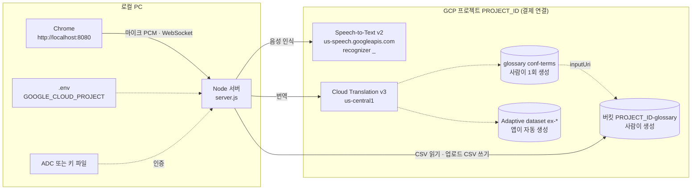
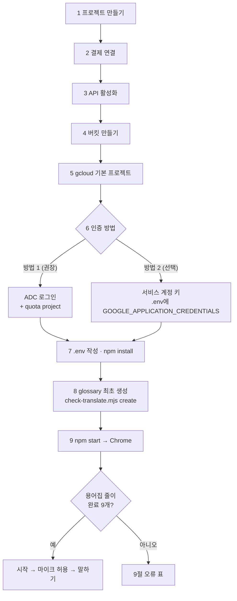

# GCP 설정 가이드

이 저장소의 앱(실시간 다국어 자막)을 **자기 Google Cloud 프로젝트를 새로 만들어** 로컬에서 실행하기까지의 절차다. 프로젝트·결제·API·버킷·glossary를 준비하고, `.env`에 프로젝트 ID를 적고, `npm start`로 띄워 Chrome에서 확인한다.

앱의 동작 방식은 [`GUIDE.md`](GUIDE.md), 설계와 API 확인 기록은 [`PLAN.md`](PLAN.md)에 있다.

## 목차

1. [5분 요약](#1-5분-요약)
2. [무엇이 필요한가](#2-무엇이-필요한가)
3. [자리표시자](#3-자리표시자)
4. [사전 요구사항](#4-사전-요구사항)
5. [단계별 절차](#5-단계별-절차)
   - [1단계: 프로젝트 만들기](#1단계-프로젝트-만들기)
   - [2단계: 결제 계정 연결](#2단계-결제-계정-연결)
   - [3단계: API 활성화](#3단계-api-활성화)
   - [4단계: 버킷 만들기](#4단계-버킷-만들기)
   - [5단계: gcloud 기본 프로젝트 지정](#5단계-gcloud-기본-프로젝트-지정)
   - [6단계: 인증](#6단계-인증)
   - [7단계: `.env` 작성과 의존성 설치](#7단계-env-작성과-의존성-설치)
   - [8단계: glossary 최초 생성](#8단계-glossary-최초-생성)
   - [9단계: 실행과 화면 확인](#9단계-실행과-화면-확인)
6. [환경 변수](#6-환경-변수)
7. [권한(IAM 역할)](#7-권한iam-역할)
8. [마이크 없이 서버 경로 확인](#8-마이크-없이-서버-경로-확인)
9. [자주 만나는 오류](#9-자주-만나는-오류)
10. [비용과 정리](#10-비용과-정리)
11. [Cloud Run 배포](#11-cloud-run-배포)
12. [참고 문서](#12-참고-문서)

---

## 1. 5분 요약

자리표시자(`PROJECT_ID`, `BILLING_ACCOUNT_ID`)를 바꿔 위에서부터 실행한다. 각 단계의 의미와 확인 방법은 [5. 단계별 절차](#5-단계별-절차)에 있다.

```bash
# 1~3. 프로젝트, 결제, API
gcloud projects create PROJECT_ID --name="google-tr"
gcloud billing projects link PROJECT_ID --billing-account=BILLING_ACCOUNT_ID
gcloud services enable speech.googleapis.com translate.googleapis.com storage.googleapis.com --project=PROJECT_ID

# 4~5. 버킷, 기본 프로젝트
gcloud storage buckets create gs://PROJECT_ID-glossary --location=us-central1 --project=PROJECT_ID
gcloud config set project PROJECT_ID

# 6. 인증(ADC)과 quota project
gcloud auth application-default login
gcloud auth application-default set-quota-project PROJECT_ID

# 7. 저장소 루트에서: .env 작성과 의존성 설치
cp .env.example .env
#    → 편집기로 .env를 열어 GOOGLE_CLOUD_PROJECT=PROJECT_ID 의 PROJECT_ID를 실제 ID로 바꾼다(안 바꾸면 8단계가 실패)
npm install

# 8. glossary.csv를 버킷에 올리고 glossary conf-terms 생성(1회)
node scripts/check-translate.mjs create

# 9. 실행 → Chrome에서 http://localhost:8080
npm start
```

---

## 2. 무엇이 필요한가

| 구성 요소 | 값(기본) | 누가 만드나 | 앱이 어디에 쓰나 |
|---|---|---|---|
| GCP 프로젝트 | `PROJECT_ID` | 사람(1단계) | 모든 API 호출의 소속. `.env`의 `GOOGLE_CLOUD_PROJECT` |
| 결제 계정 연결 | - | 사람(2단계) | API 사용료 청구. 연결이 없으면 API를 켜거나 부를 수 없다 |
| Speech-to-Text API | `speech.googleapis.com` | 사람(3단계) | 마이크 음성 스트리밍 인식(v2, `us-speech.googleapis.com`, recognizer `_`) |
| Cloud Translation API | `translate.googleapis.com` | 사람(3단계) | 번역(NMT, Translation LLM, Adaptive), glossary 조회·교체 |
| Cloud Storage API | `storage.googleapis.com` | 사람(3단계) | 용어집 CSV 저장·읽기 |
| Cloud Run, Cloud Build API | `run.googleapis.com`, `cloudbuild.googleapis.com` | 배포할 때만 | 로컬 실행에는 필요 없다([11절](#11-cloud-run-배포)) |
| 버킷 | `gs://PROJECT_ID-glossary` (`us-central1`) | 사람(4단계) | glossary의 입력 CSV를 둔다. 서버는 `start` 때마다 이 CSV를 읽어 구문 힌트·용어 강조에 쓴다 |
| glossary | `conf-terms` (`us-central1`) | 사람(8단계, 스크립트 1회) | 번역에 용어 적용. 화면의 용어집 업로드는 이미 있는 glossary의 입력 파일만 바꾼다 |
| 인증 | ADC(`gcloud auth application-default login`) 또는 서비스 계정 키 | 사람(6단계) | 서버가 Google API를 부를 때. 브라우저에는 키가 없다 |
| 버킷의 `glossary-<UTC시각>.csv` | 예: `glossary-20261114T160023503Z.csv` | **앱이 자동으로** | 화면에서 용어집을 올릴 때마다 새 객체로 쌓인다(지우지 않음) |
| Adaptive dataset | `ex-<원문>-<대상>` (예: `ex-ko-en`) | **앱이 자동으로** | 번역 모델 Adaptive + 용어집 켬일 때 언어쌍마다 처음 한 번 만든다(`examples.csv` 5쌍) |
| STT recognizer | 기본 `_` | 만들지 않는다 | 요청에 설정을 직접 넣는다 |



---

## 3. 자리표시자

명령의 대문자 값은 자기 값으로 바꾼다.

| 자리표시자 | 뜻 | 예 / 얻는 방법 |
|---|---|---|
| `PROJECT_ID` | 새로 만들 프로젝트 ID | 6~30자, 소문자·숫자·하이픈, 문자로 시작. **`google`이 들어가면 거부된다** |
| `BILLING_ACCOUNT_ID` | 결제 계정 ID | `gcloud billing accounts list`의 `ACCOUNT_ID` 열(`0X0X0X-0X0X0X-0X0X0X` 형식) |
| `USER_EMAIL` | Owner가 아닌 계정으로 실행할 때 역할을 받을 Google 계정 | [7절](#7-권한iam-역할)에서만 쓴다 |
| `SA_NAME` | 서비스 계정 이름 | 키 파일 방식([6단계 방법 2](#방법-2-서비스-계정-키-파일선택))에서만 쓴다 |
| `KEY_FILE` | 서비스 계정 키 JSON 경로 | 저장소 **밖**의 경로 |

현재 저장소 작성자는 프로젝트 `gtr-923548`, 버킷 `gtr-923548-glossary`를 쓴다. 이 값은 작성자의 `.env`에만 있고 코드에는 없다.

---

## 4. 사전 요구사항

| 항목 | 내용 |
|---|---|
| Google 계정 | 프로젝트를 만들 계정. 만든 사람은 프로젝트 Owner가 된다 |
| 결제 계정 | 프로젝트에 연결할 Cloud Billing 계정. 결제 계정에 프로젝트를 연결할 권한이 있어야 한다 |
| gcloud CLI | [설치 안내](https://docs.cloud.google.com/sdk/docs/install). 설치 후 `gcloud auth login`(또는 `gcloud init`)으로 로그인 |
| Node.js | `package.json`에 `engines`가 없어 요구 버전은 정해져 있지 않다. **확인된 버전은 v24**(개발에 사용, v24.14.0) |
| Chrome | 화면은 Chrome 기준으로 만들었다(다른 브라우저 미확인). 마이크가 필요하다 |

로그인 확인:

```bash
gcloud auth list          # 로그인한 계정에 * 표시
node -v                   # v24.x 권장
```

---

## 5. 단계별 절차



### 1단계: 프로젝트 만들기

```bash
gcloud projects create PROJECT_ID --name="google-tr"
```

- 성공하면 프로젝트 생성 작업이 끝났다는 메시지가 나온다.
- 프로젝트 ID에 `google`, `ssl` 같은 제한 문자열이 있으면 거부된다(이 저장소를 처음 준비할 때 실제로 거부됐다). 지운 프로젝트의 ID를 포함해 이미 쓰인 ID도 쓸 수 없다.

확인:

```bash
gcloud projects describe PROJECT_ID --format="value(lifecycleState)"   # ACTIVE
```

### 2단계: 결제 계정 연결

```bash
gcloud billing accounts list                     # BILLING_ACCOUNT_ID 확인
gcloud billing projects link PROJECT_ID --billing-account=BILLING_ACCOUNT_ID
```

확인:

```bash
gcloud billing projects describe PROJECT_ID     # billingEnabled: true
```

### 3단계: API 활성화

```bash
gcloud services enable speech.googleapis.com translate.googleapis.com storage.googleapis.com --project=PROJECT_ID
```

- 로컬 실행에는 이 3개면 된다. Cloud Run에 배포할 계획이면 `run.googleapis.com cloudbuild.googleapis.com`도 함께 켠다(처음 준비할 때는 5개를 한 번에 켰다).
- 결제가 연결되지 않았으면 여기서 실패한다.

확인:

```bash
gcloud services list --enabled --project=PROJECT_ID | grep -E "speech|translate|storage"
```

`speech.googleapis.com`, `translate.googleapis.com`, `storage.googleapis.com`이 보이면 된다.

### 4단계: 버킷 만들기

```bash
gcloud storage buckets create gs://PROJECT_ID-glossary --location=us-central1 --project=PROJECT_ID
```

- 버킷 이름은 **전 세계에서 유일**해야 한다. `PROJECT_ID-glossary`가 이미 쓰이고 있으면 다른 이름으로 만들고 `.env`에 `GLOSSARY_BUCKET=<그 이름>`을 적는다([6절](#6-환경-변수)).
- 리전은 glossary와 같은 `us-central1`로 둔다.

확인:

```bash
gcloud storage buckets describe gs://PROJECT_ID-glossary --format="value(location)"   # US-CENTRAL1
```

### 5단계: gcloud 기본 프로젝트 지정

```bash
gcloud config set project PROJECT_ID
```

확인:

```bash
gcloud config get-value project     # PROJECT_ID
```

### 6단계: 인증

**프로젝트 지정과 인증은 별개다.** `.env`의 `GOOGLE_CLOUD_PROJECT`는 "어느 프로젝트를 쓸지"만 정하고, "누구로 호출할지"(인증)는 따로 준비해야 한다. 인증은 서버를 띄우기 전에 그 컴퓨터에서 한 번만 하면 되고, 7단계·9단계와의 순서는 상관없다. 인증 없이도 서버는 뜨지만 첫 GCP 호출(화면을 열 때의 `GET /glossary` 등)에서 오류가 난다.

| 실행 환경 | 인증 방법 | `.env`에 적을 것 |
|---|---|---|
| 로컬 PC(브라우저 로그인 가능) | 방법 1: gcloud 로그인(ADC) | 없음 |
| 브라우저 로그인이 안 되는 서버·CI | 방법 2: 서비스 계정 키 파일 | `GOOGLE_APPLICATION_CREDENTIALS=KEY_FILE` |
| Cloud Run | 서비스에 서비스 계정을 지정(키·로그인 불필요, [11절](#11-cloud-run-배포)) | `.env`를 쓰지 않고 서비스 환경 변수로 준다 |

서버와 점검 스크립트는 Google 클라이언트 라이브러리의 표준 인증(ADC)을 쓴다. 로컬 개발에는 방법 1을 권장한다.

#### 방법 1: gcloud 로그인(ADC, 권장)

```bash
gcloud auth application-default login
gcloud auth application-default set-quota-project PROJECT_ID
```

- 첫 명령은 브라우저 로그인 창을 띄우고, 로그인하면 로컬 ADC 파일에 자격 증명을 저장한다. `gcloud auth login`(gcloud CLI 자체의 로그인)과 별개다.
- 두 번째 명령은 API 사용량과 청구를 이 프로젝트로 돌린다(quota project). 사용자 계정 자격 증명으로 Translation 등을 부를 때 필요하다. 이 명령은 ADC 계정에 그 프로젝트의 `serviceusage.services.use` 권한을 요구한다(Owner면 있다).

확인:

```bash
gcloud auth application-default print-access-token > /dev/null && echo ADC OK
```

필요 없어지면 `gcloud auth application-default revoke`로 지운다.

#### 방법 2: 서비스 계정 키 파일(선택)

서버나 CI처럼 브라우저 로그인을 할 수 없는 환경에 맞는 방법이다. 코드 변경은 필요 없다. Google 클라이언트 라이브러리는 표준 환경 변수 `GOOGLE_APPLICATION_CREDENTIALS`가 가리키는 키 파일로 인증하고, 이 저장소의 `config.js`가 Google 클라이언트를 만들기 전에 `.env`를 읽으므로 `.env`에 적어도 된다.

```bash
# 서비스 계정 만들기
gcloud iam service-accounts create SA_NAME --display-name="google-tr local"

# 역할 부여(7절 표의 역할. serviceUsageConsumer는 사용자 계정용이라 여기서는 뺀다)
gcloud projects add-iam-policy-binding PROJECT_ID \
  --member="serviceAccount:SA_NAME@PROJECT_ID.iam.gserviceaccount.com" --role="roles/speech.client"
gcloud projects add-iam-policy-binding PROJECT_ID \
  --member="serviceAccount:SA_NAME@PROJECT_ID.iam.gserviceaccount.com" --role="roles/cloudtranslate.editor"
gcloud storage buckets add-iam-policy-binding gs://PROJECT_ID-glossary \
  --member="serviceAccount:SA_NAME@PROJECT_ID.iam.gserviceaccount.com" --role="roles/storage.objectViewer"
gcloud storage buckets add-iam-policy-binding gs://PROJECT_ID-glossary \
  --member="serviceAccount:SA_NAME@PROJECT_ID.iam.gserviceaccount.com" --role="roles/storage.objectCreator"

# 키 발급(KEY_FILE은 저장소 밖 경로)
gcloud iam service-accounts keys create KEY_FILE \
  --iam-account=SA_NAME@PROJECT_ID.iam.gserviceaccount.com
```

`.env`에 한 줄 추가한다(7단계에서 만드는 파일):

```bash
GOOGLE_APPLICATION_CREDENTIALS=KEY_FILE
```

주의:

- **키 파일은 저장소에 넣지 않는다.** `.gitignore`에 `*-key.json`, `credentials*.json`이 있지만 이름이 다르면 막지 못한다. 저장소 밖에 둔다.
- 키가 유출되면 누구나 이 서비스 계정 권한으로 API를 불러 **요금이 나오고 버킷·번역 리소스에 접근**할 수 있다. 키는 기본적으로 만료되지 않는다. 필요 없어지면 지운다(`gcloud iam service-accounts keys delete KEY_ID --iam-account=SA_NAME@PROJECT_ID.iam.gserviceaccount.com`). 지운 키는 되살릴 수 없다.
- 키 파일은 발급할 때 한 번만 내려받을 수 있다.
- 조직 정책 `iam.disableServiceAccountKeyCreation`이 걸려 있으면 키를 만들 수 없다(2024-05-03 이후 만든 조직은 기본 적용). 그때는 방법 1을 쓴다.
- 이 방식으로 실제 호출이 성공하는지는 **미확인**이다. `.env`의 `GOOGLE_APPLICATION_CREDENTIALS`가 읽히는 것까지만 확인했다(존재하지 않는 경로를 주면 `Unable to read the credential file specified by the GOOGLE_APPLICATION_CREDENTIALS environment variable` 오류가 난다).
- Cloud Run에서는 키 없이 서비스에 서비스 계정을 지정하면 된다([11절](#11-cloud-run-배포)).

### 7단계: `.env` 작성과 의존성 설치

저장소 루트에서:

```bash
cp .env.example .env
```

`.env`의 `GOOGLE_CLOUD_PROJECT=PROJECT_ID`를 자기 프로젝트 ID로 고친다. 버킷 이름을 기본값과 다르게 만들었으면 `GLOSSARY_BUCKET`도 적는다. 변수 목록은 [6절](#6-환경-변수).

```bash
npm install
```

확인:

```bash
node scripts/check-csv.mjs glossary.csv
# glossary.csv 용어 9 개
# check-csv: all assertions passed
```

`check-csv.mjs`는 GCP를 부르지 않는 유일한 점검이다. 저장소의 `glossary.csv`가 앱의 검사 규칙을 통과하는지 본다.

### 8단계: glossary 최초 생성

화면의 [용어집 업로드…]는 **이미 있는** glossary의 입력 파일만 바꾸므로, 처음 한 번은 스크립트로 만든다.

```bash
node scripts/check-translate.mjs create
```

이 명령이 하는 일(`scripts/check-translate.mjs`의 `create`):

0. 같은 이름의 glossary가 이미 있는지 먼저 본다. 있으면 멈춘다(아래).
1. 저장소 루트의 `glossary.csv`를 읽어 서버와 같은 검사(`parseGlossaryCsv`)를 거친다. 칸 앞뒤 공백·빈 줄을 정리한 CSV를 만든다.
2. 그 CSV를 `gs://<GLOSSARY_BUCKET>/glossary.csv`로 올린다(기본 `gs://PROJECT_ID-glossary/glossary.csv`).
3. `projects/PROJECT_ID/locations/us-central1/glossaries/<GLOSSARY_ID>`(기본 `conf-terms`)를 10개 언어(`en, zh-CN, es, hi, pt, ru, ja, ko, fr, de`) equivalent term set으로 만들고 완료(LRO)까지 기다린다.
4. 만든 glossary를 조회해 출력한다.

성공하면 다음과 비슷하게 나온다(용어 9개 기준).

```text
uploaded gs://PROJECT_ID-glossary/glossary.csv terms 9
op projects/.../locations/us-central1/operations/...
done ms 7xxx entryCount 9
{"name":"projects/.../glossaries/conf-terms","entryCount":9,"inputUri":"gs://PROJECT_ID-glossary/glossary.csv","languageCodes":["en","zh-CN","es","hi","pt","ru","ja","ko","fr","de"],...}
```

- 같은 이름의 glossary가 이미 있으면 `이미 있습니다: ... (용어 변경은 화면의 용어집 업로드로)`를 출력하고 **아무것도 올리지 않고** 끝난다. 버킷의 `glossary.csv`(현재 glossary가 가리키는 파일일 수 있음)를 덮어쓰지 않기 위해서다.
- **이 `create` 명령은 현재 형태(업로드 포함)로 실행해 본 적이 없다(미확인).** 위 출력 예는 코드의 출력 형식과, 이전 형태(업로드 없이 생성만)로 실행했을 때 기록(용어 9행, 약 7.5초, `entryCount` 9, [`PLAN.md` 5.1절](PLAN.md#51-최초-준비-수동-1회))을 합친 것이다. 실패하면 아래 "스크립트 없이 만들 때"로 진행한다.
- 이후 용어 변경은 **화면의 [용어집 업로드…]**로 한다([`GUIDE.md` 용어집 업로드](GUIDE.md#용어집-업로드)). 서버는 로컬 `glossary.csv`가 아니라 glossary가 가리키는 버킷의 CSV를 읽는다. 로컬 파일은 보관용 사본이다.

**`glossary.csv` 형식**(서버의 `parseGlossaryCsv` 규칙, 자세한 표는 [`GUIDE.md` 용어집 CSV 작성 규칙](GUIDE.md#용어집-csv-작성-규칙)):

```csv
en,zh-CN,es,hi,pt,ru,ja,ko,fr,de
Poteto,Poteto,Poteto,Poteto,Poteto,Poteto,Poteto,Poteto,Poteto,Poteto
context window,上下文窗口,ventana de contexto,context window,janela de contexto,контекстное окно,コンテキストウィンドウ,컨텍스트 윈도우,fenêtre de contexte,Kontextfenster
```

- UTF-8(맨 앞 BOM 허용). 첫 행은 위 10개 언어 코드(순서 무관, 중복 불가). `pos`·`description` 열은 받지 않는다.
- 파일 어디에도 따옴표(`"`)를 쓸 수 없고, 쉼표로만 나누므로 **칸 안에 쉼표를 넣을 수 없다**.
- 모든 행이 10칸. 빈 칸은 되지만 한 행이 모두 비면 안 된다. 용어 행 1~1,000개, 각 칸 1,024바이트 미만.
- 번역하지 않을 고유명사는 모든 열에 같은 값을 넣는다.

**스크립트 없이 만들 때**(대체 수단): 직접 올리고 REST로 만든다. 서버의 업로드와 달리 공백 정리는 하지 않으므로 먼저 `node scripts/check-csv.mjs glossary.csv`로 검사한다.

```bash
gcloud storage cp glossary.csv gs://PROJECT_ID-glossary/glossary.csv

cat > request.json <<'EOF'
{
  "name": "projects/PROJECT_ID/locations/us-central1/glossaries/conf-terms",
  "languageCodesSet": {"languageCodes": ["en","zh-CN","es","hi","pt","ru","ja","ko","fr","de"]},
  "inputConfig": {"gcsSource": {"inputUri": "gs://PROJECT_ID-glossary/glossary.csv"}}
}
EOF

curl -X POST \
  -H "Authorization: Bearer $(gcloud auth print-access-token)" \
  -H "x-goog-user-project: PROJECT_ID" \
  -H "Content-Type: application/json; charset=utf-8" \
  -d @request.json \
  "https://translation.googleapis.com/v3/projects/PROJECT_ID/locations/us-central1/glossaries"
```

응답은 장기 실행 작업(operation)이다. 끝났는지는 몇 초 뒤 `node scripts/check-translate.mjs get`으로 `entryCount`를 보면 된다(operation 조회 URL은 미확인). glossary는 `us-central1`에만 둘 수 있다.

확인:

```bash
node scripts/check-translate.mjs get
# {"name":"projects/.../glossaries/conf-terms","entryCount":9,"inputUri":"gs://.../glossary.csv",...}
```

### 9단계: 실행과 화면 확인

```bash
npm start            # http://localhost:8080
PORT=8091 npm start  # 8080이 사용 중이면 다른 포트
```

확인(다른 터미널에서):

```bash
curl http://localhost:8080/glossary
# {"state":"ready","terms":9,"entryCount":9,"updatedAt":"2026-..."}
```

`state`가 `none`이면 8단계가 안 된 것이고, `failed`면 `error`에 원인이 나온다([9절](#9-자주-만나는-오류)).

Chrome에서 `http://localhost:8080`을 열고:

1. 용어집 줄이 `완료 용어집: 9개 · MM-DD HH:mm 갱신`이 되는지 본다. `없음 용어집 없음`이면 glossary가 없다.
2. 원문 언어, 번역할 언어(3개 이상), 인식 모델을 고르고 [시작]을 누른다.
3. 마이크 권한을 허용한다. 상태가 `연결됨`이 되면 말한다. 말하는 동안 `듣는 중`으로 바뀌고 원문 자막과 번역이 나온다.

화면 옵션과 추천 설정은 [`GUIDE.md` 사용 방법](GUIDE.md#4-사용-방법)에 있다. 실제 사람 목소리·마이크로 자막이 나오는 것은 아직 검증되지 않았다(`GUIDE.md` 맨 위 주의).

---

## 6. 환경 변수

`config.js`가 환경 변수를 읽고, 없으면 저장소 루트 `.env`를 읽는다(Node 내장 `process.loadEnvFile`). 셸에서 지정한 값이 `.env`보다 우선한다. `.env`는 `.gitignore`에 있어 커밋되지 않는다. 서버와 `scripts/`의 점검 스크립트가 모두 같은 값을 쓴다.

| 변수 | 필수 | 기본값 | 쓰이는 곳 |
|---|---|---|---|
| `GOOGLE_CLOUD_PROJECT` | 예 | 없음. 없으면 `npm start`와 GCP를 부르는 스크립트가 안내를 출력하고 종료한다 | 모든 API 경로(`projects/<ID>/...`), STT recognizer |
| `GLOSSARY_BUCKET` | 아니오 | `<GOOGLE_CLOUD_PROJECT>-glossary` | 용어집 CSV 읽기·업로드, 8단계 `create`의 업로드 위치 |
| `GLOSSARY_ID` | 아니오 | `conf-terms` | 번역의 `glossaryConfig`, 조회·교체, 8단계 `create`가 만드는 이름 |
| `GOOGLE_APPLICATION_CREDENTIALS` | 아니오 | 없음(ADC 사용) | 서비스 계정 키 파일 경로([6단계 방법 2](#방법-2-서비스-계정-키-파일선택)). 라이브러리 표준 변수 |
| `GOOGLE_CLOUD_PROJECT_NUMBER` | 아니오 | 없음 | `check-translate.mjs translate`, `check-adaptive-dataset.mjs combos`의 "프로젝트 번호 경로" 시험만. 없으면 그 시험을 건너뛴다. 앱은 쓰지 않는다 |
| `PORT` | 아니오 | `8080` | 서버 포트 |

버킷 이름을 기본값과 다르게 만들었다면(예: 이름이 이미 쓰여서) `.env`에 적는다.

```bash
GOOGLE_CLOUD_PROJECT=PROJECT_ID
GLOSSARY_BUCKET=my-other-bucket-name
```

**고정값**(환경 변수로 바꾸지 않는다, 코드 상수):

| 값 | 이유 |
|---|---|
| 리전 `us-central1` | glossary는 `us-central1`에만 둘 수 있다. 번역 호출과 Adaptive dataset도 같은 위치(`projects/<ID>/locations/us-central1`)로 부른다 |
| STT 엔드포인트 `us-speech.googleapis.com`, 위치 `us`, recognizer `_` | STT v2는 엔드포인트와 recognizer 위치가 맞아야 한다. 이 조합으로 `long`·`chirp_3`와 10개 언어 동작을 확인했다([`PLAN.md` 9절](PLAN.md#9-검증-항목-미확인-사항)) |

---

## 7. 권한(IAM 역할)

**프로젝트를 만든 본인(Owner)은 추가 역할이 필요 없다.** 아래 표는 Owner가 아닌 계정이나 서비스 계정으로 실행할 때 참고용이다. 코드가 실제로 부르는 작업 기준의 최소 기본 제공 역할이다.

| 역할 | 범위 | 필요한 이유(코드의 호출) |
|---|---|---|
| `roles/speech.client` | 프로젝트 | STT 스트리밍(`speech.recognizers.recognize`) |
| `roles/cloudtranslate.editor` | 프로젝트 | 번역(`generalModels.predict`), glossary 사용·조회·교체(`glossaries.predict`·`get`·`update`, 최초 생성 `create`), LRO 대기(`operations.get`·`wait`), Adaptive dataset 조회·생성·가져오기·번역(`adaptiveMtDatasets.get`·`create`·`import`·`predict`). `roles/cloudtranslate.user`에는 `update`·`create`·`import`가 없다 |
| `roles/storage.objectViewer` | 버킷 | `start`·`GET /glossary` 때 CSV 읽기(`storage.objects.get`) |
| `roles/storage.objectCreator` | 버킷 | 화면 업로드의 새 CSV 쓰기(`storage.objects.create`). 덮어쓰기·삭제는 못 한다. 업로드는 항상 새 이름이라 충분하다 |
| `roles/serviceusage.serviceUsageConsumer` | 프로젝트 | 사용자 계정 ADC의 quota project 지정(`serviceusage.services.use`) |

사용자 계정에 주는 예(Owner가 실행):

```bash
gcloud projects add-iam-policy-binding PROJECT_ID --member="user:USER_EMAIL" --role="roles/speech.client"
gcloud projects add-iam-policy-binding PROJECT_ID --member="user:USER_EMAIL" --role="roles/cloudtranslate.editor"
gcloud projects add-iam-policy-binding PROJECT_ID --member="user:USER_EMAIL" --role="roles/serviceusage.serviceUsageConsumer"
gcloud storage buckets add-iam-policy-binding gs://PROJECT_ID-glossary --member="user:USER_EMAIL" --role="roles/storage.objectViewer"
gcloud storage buckets add-iam-policy-binding gs://PROJECT_ID-glossary --member="user:USER_EMAIL" --role="roles/storage.objectCreator"
```

- 이 최소 역할 조합으로 실행해 본 적은 없다(Owner 계정으로만 확인). **미확인**.
- 8단계 `create`는 버킷에 `glossary.csv`가 이미 있으면(예: glossary를 지우고 다시 만들 때) 덮어쓰게 되어 `objectCreator`로는 실패한다(`roles/storage.objectUser` 필요). 처음 한 번은 새 객체라 된다.
- glossary 생성·교체 때 버킷 CSV를 읽는 주체가 호출자인지 Translation 서비스 에이전트인지는 문서에 없다(**미확인**, [`PLAN.md` 6절](PLAN.md#6-gcp-사전-설정-체크리스트)).

---

## 8. 마이크 없이 서버 경로 확인

브라우저 마이크 경로는 자동으로 확인할 수 없지만, WAV 파일을 WebSocket으로 흘려 서버의 STT → 번역 경로 전체를 확인할 수 있다. 서버를 띄운 상태에서:

```bash
MT=nmt node scripts/check-ws.mjs speech.wav en ko,ja,es            # 기본 ws://localhost:8080
MT=nmt node scripts/check-ws.mjs speech.wav en ko,ja,es ws://localhost:8091   # 다른 포트
```

- WAV는 **16kHz mono Int16(LINEAR16)**이어야 한다. 저장소에는 음성 파일이 없다(작성자는 macOS `say`와 `afconvert`로 만들었다).
- 성공하면 interim·번역 로그 뒤에 언어별 `final ko #1 "..." terms=[...] nmt 6xxms`와 `summary ko: interim translations ...` 줄이 나온다.
- 기본으로 용어집을 켜고 시작했다가 첫 final 뒤 끈다(`OFF_AFTER`). 환경 변수 목록은 스크립트 첫 줄 주석과 [`GUIDE.md` 점검 스크립트](GUIDE.md#점검-스크립트)에 있다.
- 번역·STT 요금이 나온다. `MT=adaptive`에 용어집을 켜면 Adaptive dataset을 실제로 만든다.

---

## 9. 자주 만나는 오류

| 증상 | 원인 | 해결 |
|---|---|---|
| `npm start`가 `GOOGLE_CLOUD_PROJECT(프로젝트 ID)가 설정되지 않았습니다.`를 출력하고 끝남 | `.env`가 없거나 값이 비어 있음 | 7단계. `cp .env.example .env` 후 값을 채운다 |
| `gcloud projects create`가 거부됨 | ID에 `google` 등 제한 문자열, 형식 위반, 이미 쓰인 ID | 다른 ID로 만든다([3절](#3-자리표시자) 규칙) |
| `gcloud services enable`이 실패 | 결제 계정 미연결 | 2단계 후 다시 실행 |
| 화면·`/glossary`에 `SERVICE_DISABLED`나 API가 꺼져 있다는 오류 | 3단계 API 미활성화, 또는 quota project가 다른 프로젝트 | `gcloud services list --enabled --project=PROJECT_ID`로 확인 후 활성화. quota project 확인 |
| 서버는 떴는데 화면 용어집 줄이 `실패`, `/glossary`가 `{"state":"failed","error":"용어집을 읽지 못했습니다: Could not load the default credentials. ..."}` | 인증이 없음(ADC 미설정, 키 경로도 없음). 서버는 인증 없이도 뜨고 첫 GCP 호출에서 실패한다 | 6단계 방법 1 또는 2를 마치고 서버를 다시 띄운다 |
| 위와 같은 `failed`인데 메시지가 만료·재인증 관련 | ADC가 만료됨 | `gcloud auth application-default login`을 다시 실행 |
| `Unable to read the credential file specified by the GOOGLE_APPLICATION_CREDENTIALS environment variable` | `.env`나 셸의 키 파일 경로가 틀림 | 경로를 고치거나, ADC를 쓰려면 그 줄을 지운다 |
| gcloud가 ADC quota project와 현재 프로젝트가 다르다고 경고 | 이전에 다른 프로젝트로 `set-quota-project`를 했음 | `gcloud auth application-default set-quota-project PROJECT_ID` |
| `PERMISSION_DENIED` | Owner가 아닌 계정에 역할이 빠짐. STT 오류면 `speech.client`, 번역·glossary·dataset이면 `cloudtranslate.editor`, CSV 읽기·업로드면 버킷 역할, quota project 지정 실패면 `serviceUsageConsumer` | [7절](#7-권한iam-역할) 표의 역할을 준다 |
| 화면 용어집 줄이 `없음 용어집 없음`, 업로드 버튼 비활성, `/glossary`가 `{"state":"none"}` | glossary가 없음(조회가 `NOT_FOUND`) | 8단계. `GLOSSARY_ID`를 바꿨다면 그 이름으로 만들었는지 확인 |
| 업로드 시 `용어집(conf-terms)이 아직 없습니다. 최초 생성(SETUP.md)을 먼저 하세요` | 위와 같음 | 8단계 |
| 8단계 `create`가 버킷 오류로 실패 | 4단계 버킷이 없거나 이름이 `GLOSSARY_BUCKET`과 다름 | 버킷 이름과 `.env`를 맞춘다 |
| 리전·위치 관련 오류 | glossary를 `us-central1`이 아닌 곳에 만들려 함, 또는 STT 엔드포인트·recognizer 위치를 바꿈 | 고정값을 바꾸지 않는다([6절](#6-환경-변수) 고정값 표) |
| Adaptive 칸에 `examples.csv에 en·hi 열 예문이 없습니다` 등 | `examples.csv`에 그 언어 열이 비어 있음(현재 `hi` 열이 비어 있다). 용어집 켬이면 5쌍 필요 | 다른 번역 모델을 쓰거나 `examples.csv`를 채우고 서버를 다시 띄운다 |
| `npm start`가 `EADDRINUSE`로 끝남 | 포트 사용 중 | `PORT=8091 npm start` |
| `마이크를 쓸 수 없습니다: ...` | 마이크 권한 거부, 또는 HTTPS가 아닌 원격 주소로 접속 | Chrome 사이트 설정에서 마이크 허용. HTTPS 없이는 `http://localhost`에서만 마이크가 동작한다 |

---

## 10. 비용과 정리

### 과금되는 항목

금액은 공식 가격 페이지에서 확인한다.

| 항목 | 단위 | 가격 페이지 |
|---|---|---|
| Speech-to-Text v2 | 인식한 오디오 시간(분 단위). 시작해 둔 동안 계속 스트리밍한다 | [Speech-to-Text 가격](https://cloud.google.com/speech-to-text/pricing) |
| Cloud Translation (NMT, Translation LLM, Adaptive) | 번역한 문자 수. 확정 번역은 문장마다 대상 언어 수만큼 부른다 | [Cloud Translation 가격](https://cloud.google.com/translate/pricing) |
| Cloud Storage | 버킷의 CSV 저장(작다) | [Cloud Storage 가격](https://cloud.google.com/storage/pricing) |

- **중간 번역**을 켜면 진행 중 발화 전체를 매번 다시 번역해 번역 문자 수가 늘어난다. 측정한 배수(중간/확정)는 쉼 있는 발화에서 약 1.5~2.4배, 쉼 없이 19.4초 이어 말하면 약 15배였다([`GUIDE.md` 중간 번역](GUIDE.md#중간-번역)). 비용이 걱정되면 중간 번역을 끈다.
- Translation LLM·Adaptive의 단가와 Adaptive dataset의 보관 요금 여부는 **미확인**이다.
- 점검 스크립트(`check-mt.mjs`, `check-ws.mjs` 등)도 실제 API를 불러 요금이 나온다.

### 다 쓴 뒤 정리

> [!WARNING]
> 아래 삭제 명령은 되돌릴 수 없거나 되돌리기 어렵다. 프로젝트 ID와 대상을 다시 확인하고 실행한다.

**가장 확실한 방법: 프로젝트 삭제.** 프로젝트 안의 모든 리소스와 과금이 함께 멈춘다. 삭제한 프로젝트는 일정 기간(30일) 뒤 완전히 지워지고, 그 ID는 다시 쓸 수 없다.

```bash
gcloud projects delete PROJECT_ID
```

**프로젝트를 남기고 리소스만 지울 때:**

```bash
# glossary 삭제
curl -X DELETE \
  -H "Authorization: Bearer $(gcloud auth print-access-token)" \
  -H "x-goog-user-project: PROJECT_ID" \
  "https://translation.googleapis.com/v3/projects/PROJECT_ID/locations/us-central1/glossaries/conf-terms"

# Adaptive dataset 목록(목록 URL은 미확인) → 앱이 만든 ex-* 하나씩 삭제
curl -H "Authorization: Bearer $(gcloud auth print-access-token)" -H "x-goog-user-project: PROJECT_ID" \
  "https://translation.googleapis.com/v3/projects/PROJECT_ID/locations/us-central1/adaptiveMtDatasets"
curl -X DELETE \
  -H "Authorization: Bearer $(gcloud auth print-access-token)" \
  -H "x-goog-user-project: PROJECT_ID" \
  "https://translate.googleapis.com/v3/projects/PROJECT_ID/locations/us-central1/adaptiveMtDatasets/ex-ko-en"

# 버킷과 그 안의 CSV 모두 삭제
gcloud storage rm --recursive gs://PROJECT_ID-glossary

# 로컬 ADC 자격 증명 삭제
gcloud auth application-default revoke
```

- 서버는 dataset 준비 상태를 메모리에 두므로, 서버를 띄운 채 `ex-*`를 지우면 다시 띄울 때까지 번역이 실패한다.
- `scripts/check-adaptive-dataset.mjs delete`는 점검용 `check-*` dataset만 지우고 앱이 만든 `ex-*`는 지우지 않는다.
- 서비스 계정 키를 만들었다면 키도 지운다([6단계 방법 2](#방법-2-서비스-계정-키-파일선택)).

---

## 11. Cloud Run 배포

이 문서의 범위가 아니다. 아직 배포하지 않았고, 절차는 [`PLAN.md` 8절](PLAN.md#8-간단한-배포-cloud-run)에 정리돼 있다. Cloud Run 서비스 계정에 필요한 역할은 [7절](#7-권한iam-역할)의 로컬 실행 역할과 같은 종류(`speech.client`, `cloudtranslate.editor`, 버킷의 `objectViewer`·`objectCreator`)이고, 키 파일 없이 서비스에 서비스 계정을 지정하면 된다. `.env`는 배포 소스에 넣지 않고 `GOOGLE_CLOUD_PROJECT` 등을 서비스의 환경 변수로 준다.

---

## 12. 참고 문서

- 프로젝트 만들기, ID 규칙, 삭제 후 30일: https://docs.cloud.google.com/resource-manager/docs/creating-managing-projects
- `gcloud projects delete`: https://docs.cloud.google.com/sdk/gcloud/reference/projects/delete
- `gcloud billing projects link`: https://docs.cloud.google.com/sdk/gcloud/reference/billing/projects/link
- `gcloud services enable`: https://docs.cloud.google.com/sdk/gcloud/reference/services/enable
- 버킷 만들기(이름은 전역 유일): https://docs.cloud.google.com/storage/docs/creating-buckets
- 버킷 삭제(`gcloud storage rm --recursive`): https://docs.cloud.google.com/storage/docs/deleting-buckets
- 버킷 IAM(`gcloud storage buckets add-iam-policy-binding`): https://docs.cloud.google.com/storage/docs/access-control/using-iam-permissions
- Cloud Storage 역할: https://docs.cloud.google.com/storage/docs/access-control/iam-roles
- 로컬 ADC 설정: https://docs.cloud.google.com/docs/authentication/set-up-adc-local-dev-environment
- `gcloud auth application-default set-quota-project`(필요 권한 `serviceusage.services.use`): https://docs.cloud.google.com/sdk/gcloud/reference/auth/application-default/set-quota-project
- Service Usage 역할: https://docs.cloud.google.com/iam/docs/roles-permissions/serviceusage
- Speech-to-Text 역할: https://docs.cloud.google.com/iam/docs/roles-permissions/speech
- Cloud Translation 역할: https://docs.cloud.google.com/translate/docs/access-control
- glossary(형식, `us-central1`, 생성·삭제 REST): https://docs.cloud.google.com/translate/docs/advanced/glossary
- Adaptive dataset 삭제 REST: https://docs.cloud.google.com/translate/docs/reference/rest/v3/projects.locations.adaptiveMtDatasets/delete
- 서비스 계정 만들기·역할 부여: https://docs.cloud.google.com/iam/docs/service-accounts-create
- 서비스 계정 키 만들기·삭제, 조직 정책: https://docs.cloud.google.com/iam/docs/keys-create-delete
- gcloud CLI 설치: https://docs.cloud.google.com/sdk/docs/install
- 가격: https://cloud.google.com/speech-to-text/pricing , https://cloud.google.com/translate/pricing , https://cloud.google.com/storage/pricing
